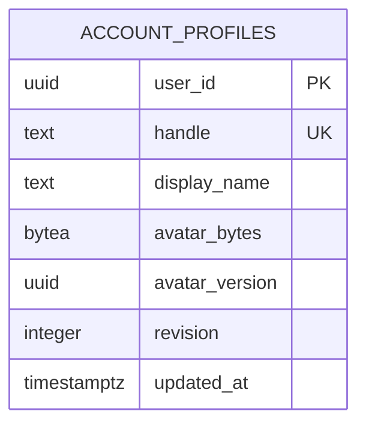

# Account names, avatars and trip members

Implemented 16 October 2026. Public names are presentation data; immutable Supabase account IDs still authorize every action and identify historical actors.

## User flow

Open **Your account** and save a display name plus unique handle. Names accept 1–60 characters; handles use 3–24 lowercase letters, numbers or underscores and start with a letter. Case-insensitive collisions return a specific error without changing either account. Name/handle edits and photo updates use a profile revision to prevent another tab silently overwriting newer changes. Existing accounts need no migration/onboarding step before using their trips.

Choose a JPEG, PNG or WebP photo (up to 10 MB and 16 megapixels). The browser shows a square crop preview and prepares a thumbnail; only **Save photo** uploads it. The server independently validates the file signature and raster format, rejects animation/oversized/corrupt images, limits concurrent processing and upload frequency, and re-encodes a 256×256 WebP without original metadata. Stored avatars are capped at 24 KiB. **Remove photo** restores initials. Failed image loading also falls back to initials.

The signed-in itinerary shows the organizer and accepted, active members with current names, handles, photos and organizer/editor/viewer labels. Profiles update on the next roster fetch, itinerary refresh or return to an organizer tab. The owner’s sharing controls list pending invitations separately and use current accepted-member names. Membership describes access, not the trip’s traveler count or participant assignments. No roster entry grants editing rights.

Account-free shared views omit the entire roster. There is no public avatar URL or profile directory. Profile/roster requests require a verified direct session; a roster additionally requires ownership or active membership. They disclose no member email addresses or immutable account IDs. This slice does not add MCP tools, OAuth permissions, participant assignments or profile editing on someone else’s behalf.

## Data and deployment

Migration **010_account_profiles.sql** adds one `account_profiles` row per configured account, with unique nullable handle, display name, bounded avatar bytes/version, revision and timestamp. An uploaded photo can precede choosing a handle. Unconfigured members use the existing invitation name, and an unconfigured organizer uses “Trip organizer”. The relation to external Supabase identity is logical; there is no database foreign key to Supabase’s managed auth schema.

RLS is enabled; public, anon and authenticated database roles have no table privileges. The existing application server performs authorized queries. Avatars are returned only in private, `no-store` JSON as bounded WebP data URLs; the existing image CSP gains `data:` while script/style restrictions remain unchanged. Photo decoding uses pinned Apache-2.0 [Sharp 0.35.5](https://sharp.pixelplumbing.com/api-constructor/) and its [metadata-free output defaults](https://sharp.pixelplumbing.com/api-output/#tobuffer). No storage bucket, API key, worker or hosting upgrade is required. With the current 20-collaborator cap, a roster’s avatar data is bounded to 21 × 24 KiB before base64 encoding; move images behind a private object store if measured scale warrants it.

## Acceptance

- Production build passes. Local suite: **108 tests, 105 passed, 3 external-PostgreSQL tests skipped**. CI runs the same suite with PostgreSQL 17.
- New tests cover handle normalization/uniqueness, concurrent profile revisions, caller-ID rejection, image signatures/dimensions/corruption/metadata removal, avatar save/removal, direct-session/origin isolation, upload limits, roster membership/revocation and anonymous projection.
- Fictional two-person browser fixture passed duplicate-handle feedback, profile save, generated-photo preview/upload, loaded thumbnail, removal to initials and roster names/photos/roles at desktop and phone width. No real profile or trip was changed.
- The browser extension could not read the local test file with its current file-access permissions. Preview/upload was verified using a photo generated by the fictional page, through the real file-change handler and upload endpoint. Native file-picker acceptance with a real photo on the user’s phone remains a joint check; no extension permissions were changed.

## Hosted release — 16 October 2026

- Code commit `b45c0bca8f4adfa9f558ac26a122309981867e17`. [CI run 38873337639](https://github.com/eddieyang-97/trip-planning-engine/actions/runs/38873337639), job `116882406089`: **108 passed, 0 failed, 0 skipped**, including PostgreSQL 17 checks.
- Existing Free Render deployment [`dep-db8tv1vavr4c73cbkd1g`](https://dashboard.render.com/web/srv-db3t3iub7d7c739hfad0/deploys/dep-db8tv1vavr4c73cbkd1g) reached **Live** in 44.0 seconds. Startup uses the migration-on-start flow and current schema version 10. `/health` returned `ok`.
- Deployed `account.js`, `account.css`, `itinerary.js` and `itinerary-views.css` match the tested build after newline normalization. Account/itinerary pages returned 200, and an unauthenticated profile request returned 401. The deployed account page opens sign-in; no real account profile was edited for acceptance.
- Additional fictional browser checks passed: saving a name preserves a pending photo preview, removal restores initials, returning to the itinerary shows current profiles, and signing out clears both account photos and the other tab's roster.
- Native photo-picker and real-account save acceptance on the user's phone remain joint checks. No extension permissions, SMTP/auth settings, real itineraries or account identities were changed. No paid plan or additional host was needed. Concurrent PRD/calendar drafts were preserved.
