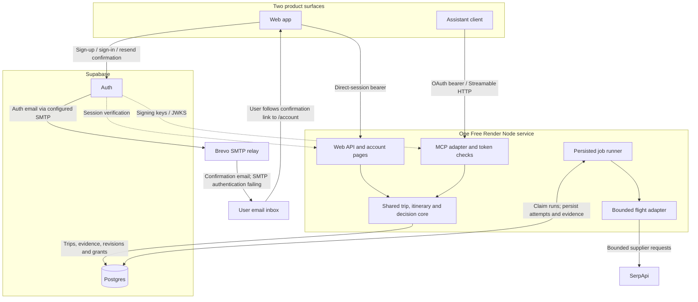
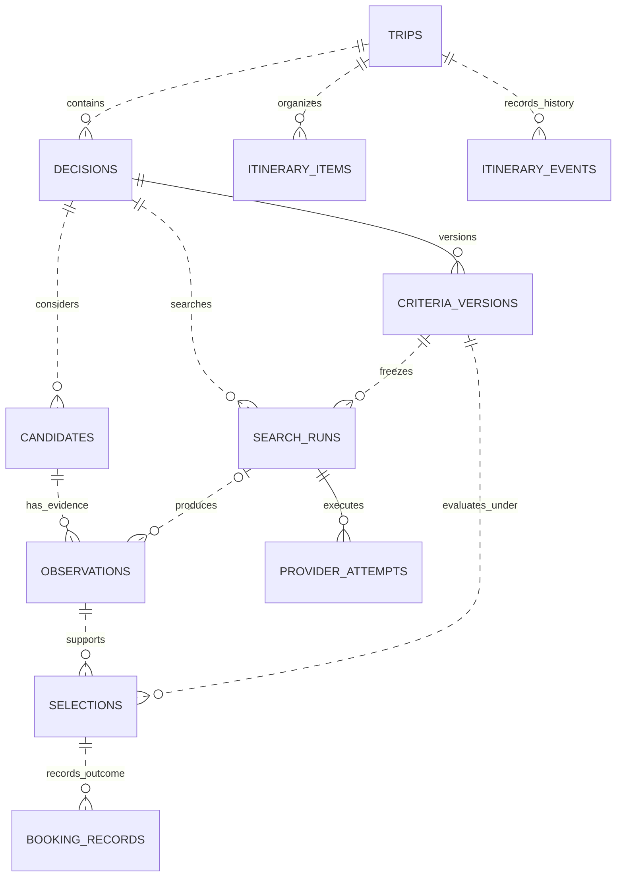

# Architecture and accepted decisions

Updated 16 October 2026. This records accepted architecture for **Trip Planning Workspace**, not the latest deployment snapshot. The initial design was validated in release `f6f1670`, and later account, map, sharing, comments and calendar changes are documented in their dated feature guides. Repository/package/service identifiers remain `trip-planning-engine`. See the [PRD](prd.md) for target behavior and [delivery status](implementation.md) for acceptance evidence.

## High-level architecture

Recorded deployed design: one Free Render service, Supabase identity/storage, Brevo SMTP configured for account-confirmation emails, and an explicitly enabled SerpApi flight pilot. Web and MCP are equal product surfaces; the service owns permissions and saved facts. After SMTP repair, second-account email confirmation, sign-in, viewer joining and organizer revocation passed.

The account pages and Supabase Auth handle direct sign-in and assistant authorization; neither surface accesses application tables directly. The runner is part of the same Node process and can pause when the Free service sleeps. No additional host, separate worker or backend LLM is required by the current design.

Supabase Auth generates the confirmation email and verification link; Brevo relays the message. SMTP credentials are held in Supabase configuration. The Render service has no direct Brevo client or email job runner. Organizers share itinerary invitation URLs themselves; creating an invitation does not send an email. See [account email configuration](account-linking.md#account-email-delivery) and [sharing acceptance](itinerary-sharing.md).

## Core data overview

This is the durable core relationship overview, not an exhaustive representation of the latest schema. [Database diagrams and the migration-extension index](database.md) cover the initial 001–006 baseline and subsequent 007–010 changes. [Data semantics](data-semantics-review.md) records the underlying invariants and unresolved concepts.

A candidate survives repeat searches; prices belong to dated observations. A selection pins exact evidence and criteria. A reported booking is a separate outcome. Manual itinerary items share the trip but do not yet have durable links to research observations. See [user flow diagrams](user-flows.md) for the corresponding journeys.

## Decisions already made

| Area | Accepted direction | Current boundary |
| --- | --- | --- |
| Product surfaces | Web and hosted MCP are first-class interfaces to one account and trip workspace | Web has manual itinerary and saved research; the full web flight workflow remains to be delivered |
| Deployment | One Node service on the existing Free Render plan, plus Supabase for Postgres and account identity | No additional host, Redis, separate worker, paid upgrade or backend LLM is part of the current deployment |
| Account email | Supabase Auth uses Brevo Free custom SMTP with a verified sender; email confirmation remains enabled | The initial SMTP failure was repaired and a second-account confirmation and sign-in passed on 14 October; wider deliverability remains unverified. Invitation URLs are shared manually |
| Shared authority | The service owns permissions, durable state, evidence, constraints and deterministic ranking | Browsers and assistants present facts and request changes; conversation memory is not authoritative |
| First live source | SerpApi powers an explicitly enabled, bounded flight-discovery pilot | One direct easyJet LGW–GVA pair for the fixed Flaine case; broader coverage and baggage-complete quotes remain unresolved |
| Evidence | Candidate identity is separate from dated offer observations; criteria versions are immutable | Synthetic, user-reported and provider-reported facts stay distinct; unknown costs are never zero |
| Outcomes | Selection and user-reported external booking are separate records | No purchase, payment, passenger submission, cancellation or ticket servicing capability |
| Itinerary | Manual items organize the full trip before further provider integrations | Saved research prepares a tentative manual draft; durable research links/reconciliation remain future work |
| Apple Calendar export | One-off .ics snapshots of individual, all or selected saved itinerary items; one combined all/selection dialog | Deployed on 15 October; hosted demo and public boundary checks passed. Saved-trip/native iPhone/iPad acceptance remains pending. Two-minute file tickets recheck source access; no Apple account integration or subscription feed |
| Collaboration | Organizer owns shared itinerary decisions; signed-in editors can edit permitted fields, signed-in members can use discussion according to role, and anonymous links are read-only | Viewer/editor invitations, revocable anonymous links and comments are implemented; proposals, approval and full hosted real-friend editor/comment acceptance remain separate goals. Invitation management uses direct web sessions |
| Expansion | Manual/sourced accommodation and dining comparison can proceed independently of advanced collaboration | Live supplier integrations require their own evidence, data-rights and provider-access gates; standalone diagnostics do not constitute hosted integrations. Voting and proposals remain deferred |

These are chosen directions, not a declaration that every capability is complete. The original paid-host and MCP-first recommendations in the [October spike](spike/README.md) are historical.

## Service boundaries

HTTP/web, MCP, core and the runner share one deployment and one TypeScript package. Local development uses loopback authentication, PGlite and a synthetic fixture runner; hosted mode uses external Postgres and enables live work only with both the server flag and provider key. Hosted fixtures are disabled.

Transport adapters validate requests and establish identity. Core operations enforce ownership, applicable grants, idempotency and revision rules. `itinerary.ts`, `itinerary-research.ts` and `policies.ts` provide focused domain operations. `live-search.ts` owns admission, attempt persistence and recovery; `live-provider.ts` normalizes supplier meaning. `database.ts` owns adapters and migrations. Separate deployments require a demonstrated workload need.

## Accounts and authorization

Account identity is the verified Supabase user UUID, never an email match, chat identity or caller-supplied owner field. The browser uses a direct confirmed-account session. MCP uses asymmetric JWT validation for issuer, exact resource audience, expiry, client identity and stored grant version. Application read/write/search grants are separate from OAuth identity scopes. Search requires write plus explicit search consent.

Direct web operations use a server-only allowlist and ownership checks; they do not create assistant grants. MCP rechecks stored permissions/version for each operation. Web writes require the exact Origin; account and itinerary pages have restrictive CSP and render user content as text. See [account linking](account-linking.md).

RLS denies direct browser/Data API access. The current privileged runtime connection can bypass RLS, so application ownership checks remain essential. Separate migration/runtime roles, abuse throttling and a common membership authorization model remain hardening work. Collaboration must apply trip roles to both surfaces and distinguish shared trip evidence from account-private policy notes and booking detail.

## Persistent model and consistency

[The database ER diagrams](database.md) are the schema reference for keys and relationships. Supabase accounts are verified external identities, not a local users table or an enforced `auth.users` foreign key.

Money uses exact integer minor units and an explicit passenger/currency basis. Criteria changes append versions; later searches do not overwrite evidence or earlier selections. Candidate disposition survives repeat searches. Policy references pin exact versions and never establish offer-specific equipment entitlement or price.

Mutations carry idempotency keys; mutable decision, itinerary and policy updates also require the current revision/version. Locks and transactions serialize writes. Core reads use read-only repeatable-read snapshots, keeping revisions and related contents consistent. Airport-local evaluation and flight identity derive from reviewed airport zones; unknown zones remain unresolved. See [correctness fixes](correctness-fixes.md).

The repository now contains numbered migrations 001–010: editor roles (007), anonymous view links (008), item/trip comments (009) and account profiles (010) extend the initial 001–006 baseline. The [database reference](database.md) distinguishes the original ER snapshots from these extensions. Dated [delivery evidence](implementation.md) and [feature guides](README.md) determine what was verified in a particular hosted release; source presence alone is not deployment proof. JSONB stores validated snapshots alongside normalized ownership/version relationships. The larger schema/interfaces in `spike/design/` remain proposals. General typed output contracts, full history pagination, structured actual booking amounts, broader passenger/baggage modeling and evidence deletion/retention still need implementation.

## Concurrency, consistency and scaling trade-offs

These are intentional **private-pilot choices**, not claims of real-time collaboration, linearizable external effects or measured production throughput. Preserve the guarantees when changing database access, web/MCP operations or worker behavior.

1. **Consistent reads, not latest-at-response-time.** Core reads use read-only PostgreSQL `REPEATABLE READ` transactions, so an itinerary revision, items, history and related evidence come from the same snapshot. A request whose snapshot authorized access may finish after a concurrent revocation commits; a *new* request must observe the revocation. **Trade-off:** correct cross-query views can be briefly stale. **Revisit when:** actual workflows need push updates or stricter read-versus-revocation ordering; do not add a read lock simply to make every view fresher.
2. **Selective pessimistic writes, not blanket serializability.** Write transactions use PostgreSQL's default `READ COMMITTED` isolation with explicit row locks and database constraints: itinerary and sharing mutations coordinate on the trip row, decision mutations on the decision row, and quota admission on a transaction-scoped advisory lock. **Trade-off:** less retry overhead than universally using `SERIALIZABLE`, but every new writer must respect the relevant lock order and enforce its own invariants. **Revisit when:** a demonstrated write-skew case or new cross-entity invariant cannot be protected cleanly with these locks and constraints.
3. **One trip-wide itinerary revision.** Competing item edits compare `expectedRevision` after acquiring the trip lock; only one stale-revision writer succeeds. Even two edits to unrelated items can conflict. **Trade-off:** simple, audit-friendly history and no silent lost updates, at the cost of unnecessary conflicts and manual reload/review. **Revisit when:** measured `REVISION_CONFLICT` frequency or real collaborators' draft loss justifies item-level versions or an explicit merge UX; never silently replay stale edits.
4. **Independent clocks for distinct concerns.** `itinerary_revision`, decision revisions/criteria versions and profile revisions protect different write sets. Discussion posts and provider-run results do **not** universally increment the itinerary revision. **Trade-off:** unrelated activity does not invalidate itinerary edits, but an unchanged itinerary revision is not proof that comments, research or member profiles are fresh. **Revisit when:** a real multi-surface workflow requires a joined change feed or explicit workspace cursor.
5. **Idempotent application mutations, not exactly-once supplier operations.** `mutation_requests` keys and request hashes deduplicate identical command retries; different keys can still express distinct commands. The metered search runner records attempts before dispatch and marks ambiguous/lost acknowledgements `outcome_unknown` rather than automatically resending them. **Trade-off:** favors integrity and spending limits over guaranteed completion. **Revisit when:** booking/payment integrations require supplier correlation, reconciliation, compensation and their own idempotency semantics.
6. **Small shared capacity and process-local utilities.** The hosted PostgreSQL pool is capped at **five connections per process**; multi-query snapshot reads occupy a connection, and same-trip writes queue behind the trip lock. Browser updates are refresh-driven, not push-synchronized. Calendar-download tickets and some HTTP rate-limit counters are process-local; the current one-service design does not promise durable tickets or cross-instance quotas. **Trade-off:** minimal infrastructure and straightforward operations, but potential contention and single-instance assumptions. **Revisit when:** measured p95 latency/pool waits, edit-conflict rates, user demand for live updates, or a concrete multi-instance rollout warrants shared admission/tickets and stronger coordination.

**Verification boundary:** Controlled [pooled PostgreSQL read](read-consistency.test.ts) and [sharing](../tests/sharing-postgres.test.ts) tests are the intended proof of these particular interleavings; they are not a capacity benchmark. For implementation details use [database.ts](../src/database.ts), [itinerary.ts](../src/itinerary.ts), [core.ts](../src/core.ts), and [live-search.ts](../src/live-search.ts). Keep the current [quality and scale-readiness gates](prd.md#10-quality-and-operating-requirements) proportional to demonstrated traffic.

## Live execution and pilot limits

`start_search` persists a run and reserves three request slots before returning its ID. Current allowances are two runs per owner per rolling day, four globally per rolling day and twenty globally per rolling 30 days. Admission and worker concurrency are serialized in Postgres. These are configured pilot ceilings, separate from supplier quota and standalone diagnostic usage.

One live job runs at a time. Each potentially metered request has a committed attempt before transmission; permissions/version are checked between stages and before saving. Requests time out after 30 seconds; the lease is three minutes and queued jobs expire after one hour. Interrupted running work becomes `outcome_unknown` and is never automatically resent. Fixture lease recovery remains separate. See [the flight guide](hosted-live-search.md) for exact behavior and rollback.

The runner progresses while the Free Render process is awake; saved work can pause during sleep. Startup/timer recovery uses durable state, and polling never initiates another supplier search. The pilot promises persistent status and conservative recovery, not always-on progress or exactly-once external requests.

The adapter retains up to ten seller observations for one sampled pair with partial airport coverage. Unknown party-price basis, equipment, expiry and bookability remain visible even when a run completes. Completion does not imply a complete or recommended trip. Broader storage/redisplay rights, retention enforcement and exact supplier quote checks remain gates for expansion.

## Organizer and next milestones

The organizer maintains manual flight, accommodation, transfer, activity, restaurant and note items, with tentative/reported-booked labels and change history. The saved-research projection uses the same read snapshot and bounds decisions, recent observations and pinned outcomes. Reviewing a flight opens a draft; saving creates/updates a manual item. The draft is a snapshot, not a durable research link or automatic update.

Complete the organizer foundation across web and MCP: direct web flight controls, honest comparisons, explicit research links/reconciliation and actual edit continuity. Viewer/editor invitations, anonymous view links and member discussion now have implementation and dated acceptance evidence; hosted acceptance varies by user journey. Later proposals and organizer approval remain conditional. Preserve history and private-booking visibility rules. These capabilities do not themselves require a new provider or additional infrastructure.

Calendar export serializes the saved itinerary into iCalendar (.ics) files using one exporter for the individual action and combined all/selection flow. It reuses existing trip read permissions and privacy projections without mutating trip state. A bounded in-memory ticket grants access to one frozen file for two minutes; delivery rechecks the original authenticated session or view-link access. Native Calendar can follow that file URL without receiving the web bearer header. Text/calendar delivery preserves known instants and exclusive all-day ends. No database schema or additional service is needed. Apple account integration, subscriptions and synchronization are outside this slice. See [calendar requirements](prd.md#calendar-export), [implementation and access details](calendar-export.md) and [earlier device evidence](apple-calendar-probe.md); the deployed release is documented in [hosted release evidence](release-calendar-comments-2026-10-15.md), with saved-trip/native acceptance still pending.

Outstanding operating work includes least-privilege database roles, throttling, bounded public output contracts, consent recovery, retention/deletion/export, telemetry and backup/restore. [Delivery status](implementation.md) distinguishes completed proof from remaining acceptance; the [architecture review](architecture-review.md) preserves the original findings.
