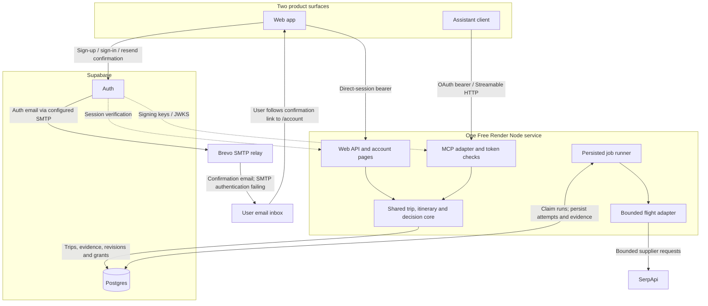
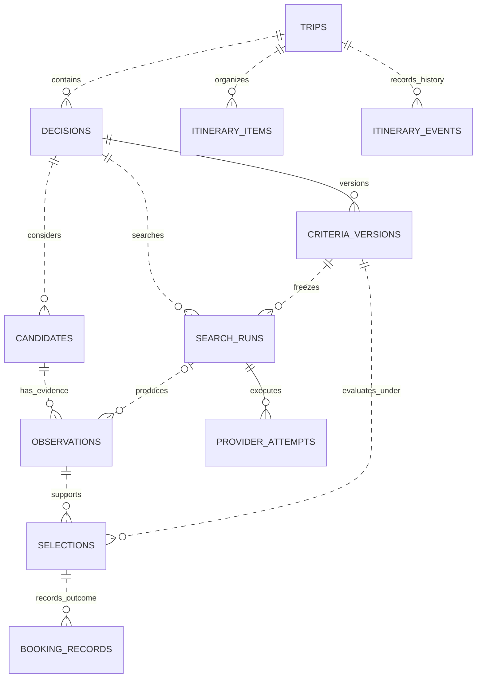

# Architecture and accepted decisions

This records accepted architecture for **Trip Planning Workspace**, not the latest deployment snapshot. The initial design was validated in release `f6f1670`, and later account, map, sharing, comments and calendar changes are documented in their dated feature guides. Repository/package/service identifiers remain `trip-planning-engine`. See the [PRD](prd.md) for target behavior and [delivery status](implementation.md) for acceptance evidence.

## High-level architecture

Recorded deployed design: one Free Render service, Supabase identity/storage, Brevo SMTP configured for account-confirmation emails, and an explicitly enabled SerpApi flight pilot. Web and MCP are equal product surfaces; the service owns permissions and saved facts. After SMTP repair, second-account email confirmation, sign-in, viewer joining and organizer revocation passed.

The account pages and Supabase Auth handle direct sign-in and assistant authorization; neither surface accesses application tables directly. The runner is part of the same Node process and can pause when the Free service sleeps. No additional host, separate worker or backend LLM is required by the current design.

Supabase Auth generates the confirmation email and verification link; Brevo relays the message. SMTP credentials are held in Supabase configuration. The Render service has no direct Brevo client or email job runner. Organizers share itinerary invitation URLs themselves; creating an invitation does not send an email. See [account email configuration](account-linking.md#account-email-delivery) and [sharing acceptance](itinerary-sharing.md).

## Core data overview

This is the durable core relationship overview, not an exhaustive representation of the latest schema. [Database diagrams and the migration-extension index](database.md) cover the initial 001–006 baseline and subsequent 007–011 changes. [Data semantics](data-semantics-review.md) records the underlying invariants and unresolved concepts.

A candidate survives repeat searches; prices belong to dated observations. A selection pins exact evidence and criteria. A reported booking is a separate outcome. Manual items remain independent; the deployed accommodation extension below adds durable links for explicitly reviewed stays. See [user flow diagrams](user-flows.md) for the corresponding journeys.

## Decisions already made

| Area | Accepted direction | Current boundary |
| --- | --- | --- |
| Product surfaces | Web and hosted MCP are first-class interfaces to one account and trip workspace | Web has manual itinerary and saved research; the full web flight workflow remains to be delivered |
| Deployment | One Node service on the existing Free Render plan, plus Supabase for Postgres and account identity | No additional host, Redis, separate worker, paid upgrade or backend LLM is part of the current deployment |
| Account email | Supabase Auth uses Brevo Free custom SMTP with a verified sender; email confirmation remains enabled | The initial SMTP failure was repaired and a second-account confirmation and sign-in passed on 14 October; wider deliverability remains unverified. Invitation URLs are shared manually |
| Shared authority | The service owns permissions, durable state, evidence, constraints and deterministic ranking | Browsers and assistants present facts and request changes; conversation memory is not authoritative |
| First live source | Bounded generalized SerpApi flight discovery runs in the existing service (F1/F2 closed) | Live multi-origin return discovery and a later connected ChatGPT conditional selection/read-back passed; refreshed ChatGPT one-way criteria, current server/client metadata and independent Claude read-only retrieval also passed. A single hosted new-search-to-selection pass remains unverified. Complete party/equipment quotes and booking remain unverified; see [#21](https://github.com/eddieyang-97/trip-planning-engine/issues/21) |
| Evidence | Candidate identity is separate from dated offer observations; criteria versions are immutable | Synthetic, user-reported and provider-reported facts stay distinct; unknown costs are never zero |
| Outcomes | Selection and user-reported external booking are separate records | No purchase, payment, passenger submission, cancellation or ticket servicing capability |
| Itinerary | Manual items organize the full trip before further provider integrations | Flight research prepares a tentative manual draft; the deployed accommodation extension adds an explicit durable selected-stay link. General reconciliation remains future work |
| Apple Calendar export | One-off .ics snapshots of individual, all or selected saved itinerary items; one combined all/selection dialog | Deployed on 15 October; hosted demo and public boundary checks passed. Saved-trip/native iPhone/iPad acceptance remains pending. Two-minute file tickets recheck source access; no Apple account integration or subscription feed |
| Collaboration | Organizer owns shared itinerary decisions; signed-in editors can edit permitted fields, signed-in members can use discussion according to role, and anonymous links are read-only | Viewer/editor invitations, revocable anonymous links and comments are implemented; proposals, approval and full hosted real-friend editor/comment acceptance remain separate goals. Invitation management uses direct web sessions |
| Expansion | Manual/sourced accommodation and dining comparison can proceed independently of advanced collaboration | Live supplier integrations require their own evidence, data-rights and provider-access gates; standalone diagnostics do not constitute hosted integrations. Voting and proposals remain deferred |

These are chosen directions, not a declaration that every capability is complete. The original paid-host and MCP-first recommendations in the [October spike](spike/README.md) are historical.

## Service boundaries

HTTP/web, MCP, core and the runner share one deployment and one TypeScript package. Local development uses loopback authentication, PGlite and a synthetic fixture runner; hosted mode uses external Postgres and enables live work only with both the server flag and provider key. Hosted fixtures are disabled.

Transport adapters validate requests and establish identity. Core operations enforce ownership, applicable grants, idempotency and revision rules. `itinerary.ts`, `itinerary-research.ts` and `policies.ts` provide focused domain operations. `live-search.ts` owns admission, attempt persistence and recovery; `live-provider.ts` normalizes supplier meaning. `database.ts` owns adapters and migrations. Separate deployments require a demonstrated workload need.

## Accounts and authorization

Account identity is the verified Supabase user UUID, never an email match, chat identity or caller-supplied owner field. The browser uses a direct confirmed-account session. MCP uses asymmetric JWT validation for issuer, exact resource audience, expiry, client identity and stored grant version. Application read/write/search grants are separate from OAuth identity scopes. Search requires write plus explicit search consent.

Direct web operations use a server-only allowlist and ownership checks; they do not create assistant grants. MCP rechecks stored permissions/version for each operation. Web writes require the exact Origin; account and itinerary pages have restrictive CSP and render user content as text. See [account linking](account-linking.md).

RLS denies direct browser/Data API access. The current privileged runtime connection can bypass RLS, so application ownership checks remain essential. Separate migration/runtime roles, abuse throttling and a common membership authorization model remain hardening work. Collaboration must apply trip roles to both surfaces and distinguish shared trip evidence from account-private policy notes and booking detail.

The numbered application migrations enforce that private-table boundary. A
[21 October investigation](database-security-2026-10-21.md) found that bootstrap
metadata `app_schema_migrations` lacked equivalent protection. The deployed
bootstrap fix enables RLS and revokes PUBLIC/browser grants on every migration
run, including current-version databases. Its local tests pass; the approved live metadata repair and private follow-up audit passed. Supabase's October 30 Data
API grant default does not require exposing tables used through direct Postgres.

## Persistent model and consistency

[The database ER diagrams](database.md) are the schema reference for keys and relationships. Supabase accounts are verified external identities, not a local users table or an enforced `auth.users` foreign key.

Money uses exact integer minor units and an explicit passenger/currency basis. Criteria changes append versions; later searches do not overwrite evidence or earlier selections. Candidate disposition survives repeat searches. Policy references pin exact versions and never establish offer-specific equipment entitlement or price.

Mutations carry idempotency keys; mutable decision, itinerary and policy updates also require the current revision/version. Locks and transactions serialize writes. Core reads use read-only repeatable-read snapshots, keeping revisions and related contents consistent. Airport-local evaluation and flight identity derive from reviewed airport zones; unknown zones remain unresolved. See [correctness fixes](correctness-fixes.md).

The repository now contains numbered migrations 001–012: editor roles (007), anonymous view links (008), item/trip comments (009) account profiles (010) trip lifecycle (011) and research archive/restore (012) extend the initial 001–006 baseline. The [database reference](database.md) distinguishes the original ER snapshots from these extensions. Dated [delivery evidence](implementation.md) and [feature guides](README.md) determine what was verified in a particular hosted release; source presence alone is not deployment proof. JSONB stores validated snapshots alongside normalized ownership/version relationships. The larger schema/interfaces in `spike/design/` remain proposals. General typed output contracts, full history pagination, structured actual booking amounts, broader passenger/baggage modeling and broader provider-data retention still need implementation; trip deletion/retention is covered by the lifecycle extension below.

## Research decision visibility

Migration 012 adds paired archive actor/time fields and an append-only decision lifecycle journal keyed by decision ID/revision. Owner web/MCP transitions lock trip then decision, check expected decision revision and reuse mutation-request idempotency. Retries recheck ownership and current state/revision; an old receipt cannot reverse an intervening restore/archive. Any booking report through any selection blocks archive under the same locks as booking writes. Default trip and owner itinerary research exclude archived decisions; explicit paginated discovery and direct retrieval remain owner-only. New research writes require restoration, but already admitted workers continue recording evidence/accounting. No itinerary, selection, booking or quota rewrite; restore does not search or recompute. Journal retention follows permanent trip deletion. Older code ignores visibility: use forward recovery or restore all decisions before rolling back to older code. See [semantics](data-semantics-review.md#research-archive-issue-24).

## Concurrency, consistency and scaling trade-offs

These are intentional **private-pilot choices**, not claims of real-time collaboration, linearizable external effects or measured production throughput. Preserve these guarantees when changing database access, web/MCP operations or worker behavior.

1. **Consistent reads, not latest-at-response-time.** Core reads use read-only PostgreSQL `REPEATABLE READ` transactions; revision, items, history and related evidence come from one snapshot. A read whose snapshot authorized access can finish after revocation commits; a *new* read must see the revocation.
   - **Trade-off:** Correct cross-query views can be briefly stale.
   - **Revisit when:** A verified user journey needs push updates or stronger revocation ordering; do not add read locks solely to force fresher results.
2. **Selective pessimistic writes, not blanket serializability.** Write transactions use PostgreSQL's default `READ COMMITTED` isolation with explicit row locks and constraints: trip mutations/sharing coordinate on the trip row, decision mutations on the decision row, and metered-admission on an advisory lock.
   - **Trade-off:** Less retry overhead than universal `SERIALIZABLE`, but every new writer must maintain lock ordering and protect any new cross-entity invariants.
   - **Revisit when:** A demonstrated write-skew bug or cross-entity invariant cannot be enforced cleanly with these locks and constraints.
3. **One trip-wide itinerary revision.** Competing item edits compare `expectedRevision` after taking the trip lock; a stale writer fails, even if it modifies a different item.
   - **Trade-off:** Simple, auditable history and no silent lost updates, at the cost of avoidable conflicts and manual reload/review.
   - **Revisit when:** Measured `REVISION_CONFLICT` rates or repeated user draft loss warrant per-item versions or a deliberate merge UX; never silently replay stale edits.
4. **Independent clocks for distinct concerns.** `itinerary_revision`, decision/criteria versions and account-profile revisions protect different write sets; comments and provider-run results do not universally increment the itinerary revision.
   - **Trade-off:** Unrelated activity does not invalidate itinerary edits, but an unchanged itinerary revision says nothing about comment, research or roster freshness.
   - **Revisit when:** A real multi-surface workflow needs a joined change feed or explicit workspace cursor.
5. **Idempotent mutations, not exactly-once external work.** `mutation_requests` keys plus request hashes deduplicate identical commands; a fresh key is a distinct command. The live runner records metered attempts before dispatch and marks ambiguous/lost acknowledgements `outcome_unknown`, without auto-replay.
   - **Trade-off:** Favors integrity and spending limits over guaranteed supplier-job completion.
   - **Revisit when:** Booking or payments require supplier idempotency, correlation, reconciliation, compensation and explicit recovery.
6. **Small shared capacity and process-local utilities.** The hosted PostgreSQL pool allows **five connections per process**; multi-query reads hold a connection and same-trip writes queue on its row lock. Web freshness is refresh-driven, not push-synchronized. Calendar tickets and some HTTP rate counters live in process memory.
   - **Trade-off:** Minimal infrastructure, but contention and single-instance assumptions; tickets do not survive process restarts and per-process limits are not global.
   - **Revisit when:** Measured p95 latency, pool waits, conflict rates, demand for live updates or a planned multi-instance rollout justifies shared admission/tickets and stronger coordination.

**Evidence boundary:** Controlled [pooled PostgreSQL read](../tests/read-consistency.test.ts), [sharing](../tests/sharing-postgres.test.ts) and [admission](../tests/live-admission-postgres.test.ts) tests exercise selected interleavings, not throughput. The [database adapter](../src/database.ts), [itinerary service](../src/itinerary.ts), [core](../src/core.ts) and [live runner](../src/live-search.ts) implement these choices. Observe the [quality/scale readiness gates](prd.md#10-quality-and-operating-requirements) before broadening traffic or enabling consequential external effects.

## Live execution and pilot limits

The same service hosts HTTP/web, MCP and a durable PostgreSQL-backed runner. Live supplier dispatch is **opt-in and metered**: admission checks user/grant permission, explicit consent, request quotas and idempotency; it persists each attempt **before** external I/O. A known failure can preserve partial evidence; a lost acknowledgement or expired lease becomes `outcome_unknown` and must **not** be blindly replayed. Process interruption cannot erase admitted attempt state or exceed the reservation ceiling.

The present SerpApi adapter supports bounded multi-origin flight discovery, capped return expansions or origin-specific one-way queries, immutable evidence and explicit partial coverage. Unknown party price basis, snowboard fees, seller rights and bookability remain unknown; selection is not a purchase. Technical query bounds, timeout/lease rules, result normalization, airport/time-zone handling and safe recovery are in the [flight-search contract](hosted-live-search.md) and [release runbook](releases.md); dated client/CI acceptance belongs to the corresponding Issues and PRs.

## Organizer and web/MCP continuation

The web organizer maintains manual flights, accommodation, transfers, activities, dining and notes with change history and privacy projections. Authorized web and MCP operations share IDs, snapshots and revision checks. Current flight saved-research review can prepare a manual itinerary draft; that draft is not an automatically reconciled durable link. The accommodation path introduces an explicit reviewed tentative-item link with frozen evidence and separate revisions; see [accommodation](accommodation-comparison.md).

Calendar export produces a one-off .ics snapshot and checks authorization before delivery; it does not synchronize with Apple Calendar. Anonymous view links, named editors and comments preserve distinct access roles. See [calendar export](calendar-export.md), [sharing](itinerary-sharing.md) and [current delivery boundaries](implementation.md). Future workflow priorities live in GitHub Issues, not this architectural contract.

## Trip lifecycle extension - 16 October 2026

Migration 011 and the [trip lifecycle guide](trip-lifecycle.md) add owner archive/restore, confirmed permanent deletion and personal membership exit. Archive preserves sharing. Delete physically removes the trip graph and clears scoped cached response content; minimal tombstones/retry guards prevent resurrection. A quota-only reservation ledger survives deletion so live allowance cannot reset.

The lifecycle revision is a separate whole-workspace review clock; content/access changes and worker state changes advance it. It does not replace or broaden itinerary edit conflicts. To enforce deletion across research and provider writers, mutations now lock the trip before decision/run/item rows; live admission/claim take the existing advisory admission lock first, then trip and child locks. Recovery uses root-before-child ordering too. This deliberately serializes same-trip writes for the private pilot while preserving READ COMMITTED writes and snapshot reads. No lock spans supplier I/O. An admitted request may finish after deletion, but no further stage or evidence write can use the deleted trip. The controlled [delete/editor race](../tests/trip-lifecycle-postgres.test.ts) supplements the existing concurrency evidence; no throughput claim is made.

Confirmation tokens are hashed, short-lived, one-use and bound to the exact account/client/action/revision. MCP requires host-enforced explicit user confirmation and destructive tool annotations. See the feature guide for backup limitations, retained metadata and forward recovery; an old worker must not resume live admission against a post-deletion database.

## Accommodation research extension — 25 October 2026

[Issue #9](https://github.com/eddieyang-97/trip-planning-engine/issues/9) adds a narrow typed lodging path within the existing modular service. Web and MCP call the same owner-authorized operations. It reuses decisions, candidates, dated observations, frozen selections, revisions and mutation receipts; decision kind separates stay criteria from flight offers. There is no new supplier adapter, model runtime, service or queue.

A selected stay is explicitly reviewed before creating a tentative itinerary item. The protected selected-stay relationship pins the exact research origin and approval-time evidence; later observations or selections cannot rewrite that item. The unique selection relationship, trip-before-decision locks and separate current decision/itinerary revisions prevent duplicate or stale commits. Private research and origin snapshots stay out of member/anonymous views. Existing manual items and the flight draft flow remain independent.

See [accommodation semantics](data-semantics-review.md#sourced-accommodation-comparison-issue-9-25-october-2026), [feature behavior](accommodation-comparison.md) and [delivery evidence](implementation.md). Migration 013 was included in the merged [PR #36](https://github.com/eddieyang-97/trip-planning-engine/pull/36) and its hosted rollout; persisted fictional ChatGPT → web → MCP stay records exercised the lodging relationship. [Issue #9](https://github.com/eddieyang-97/trip-planning-engine/issues/9) is closed for the bounded manual/sourced pilot, not live supplier or independent Claude acceptance. Old flight-only code must not be rolled back blindly after lodging records exist.

## Dining research extension — 27 October 2026

The typed dining path follows the established stay pattern with its own validated criteria/observation/evaluation and owner-private tools. It reuses the research graph, shared web/MCP dispatch, trip-before-child locks, mutation receipts and exact selected-evidence linkage. Migration 014 adds a dining kind and service-only dining-to-itinerary relation; no runtime, supplier feed or infrastructure is added. Shared items disclose practical venue/meal details while menu/dietary research, rationale and origin remain private. Expected meal costs and reported reservation links never establish a guaranteed quote or table. See [semantics](data-semantics-review.md#sourced-dining-comparison-issue-10-27-october-2026), [dining contract](dining-comparison.md) and [verified delivery](implementation.md). Source presence is not deployment evidence.
