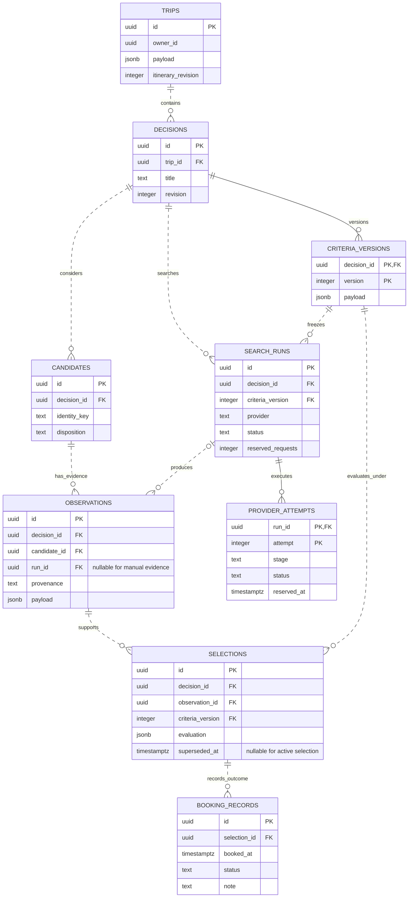
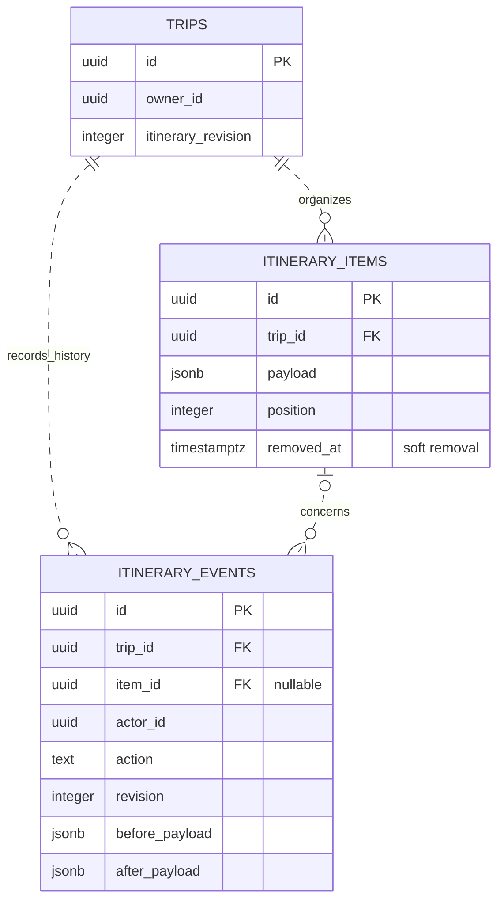
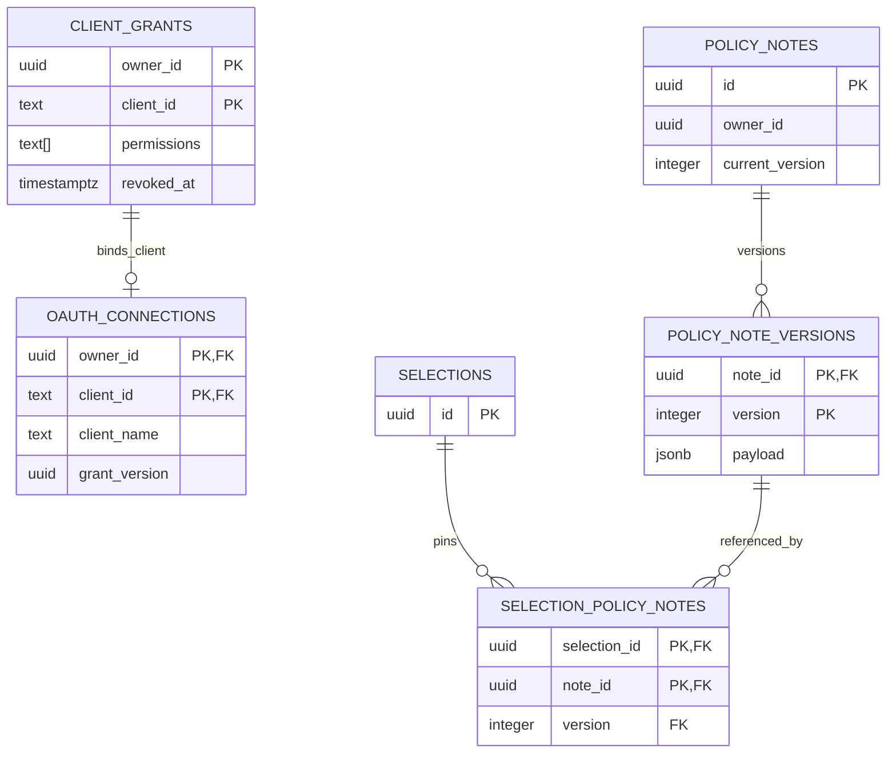
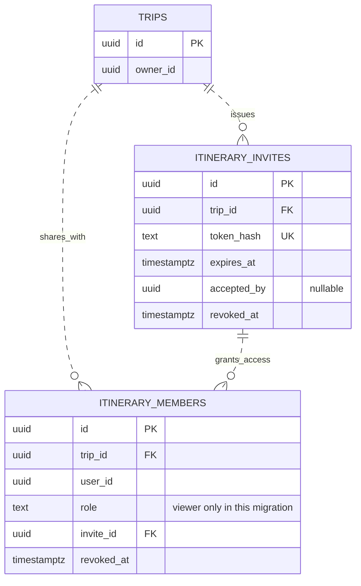

# Database ER diagrams

Updated 14 October 2026. These diagrams describe the recorded deployed schema, migrations **001–006**, including the viewer-sharing extension below. Start with the [high-level architecture](architecture.md#high-level-architecture), then use the diagrams below for relationships and keys. See [user flows](user-flows.md) for how people use the model.

Entity names match SQL table names, shown in uppercase for readability. Attributes are selected fields, not complete DDL. `PK` marks a primary-key component; `FK` marks a foreign-key component. Solid lines identify a child through its parent key; dashed lines are non-identifying relationships. Both represent enforced foreign keys here; dashed does **not** mean planned. A circle allows zero, a bar means one, and a crow's foot means many. See [Mermaid's notation reference](https://mermaid.js.org/syntax/entityRelationshipDiagram.html).

## Flight research and outcomes

Sources: [migration 001](../migrations/001_initial.sql) and [migration 005](../migrations/005_live_search.sql).

A candidate is the stable flight pair; each observation is a separate dated seller/fare/price report. A run references one immutable criteria version. Manual observations have no run. Composite foreign keys carry `decision_id` alongside candidate, run, observation and criteria references, preventing cross-decision evidence links.

Selections pin exact evidence and evaluation. There can be many historical selections, but a partial unique index allows only one unsuperseded selection per decision. A booking record is a separate user report, not a supplier transaction. The live run reserves request allowance; its attempts preserve stages and uncertain outcomes independently of the offer payload.

## Itinerary and history

Source: [migration 004](../migrations/004_itinerary.sql).

The trip revision serializes plan changes; item ordering and optional local dates/times live in the current plan. Removal hides an item while preserving its row and history. `actor_id` records the authenticated account; it is not a foreign key to a local users table.

There is **no persistent foreign key from an itinerary item to a research observation or selection** in this release. The web page reads research from the trip's decisions and can prepare a tentative manual snapshot. A source URL or copied note is not a durable research link, and subsequent searches do not update the manual item automatically.

## Assistant grants and private policy references

Sources: [migration 002](../migrations/002_account_linking.sql) and [migration 003](../migrations/003_policy_notes.sql), with grants introduced in migration 001.

The grant and OAuth connection share `(owner_id, client_id)`. A local-development grant can exist without an OAuth connection. Version rotation invalidates earlier assistant tokens; revocation removes application access without waiting for token expiry.

Private policy notes belong to an account and may be reused across its trips. Selection references pin `(note_id, version)`; they never supply missing quote costs or verify equipment carriage. `current_version` is managed transactionally by the application, rather than enforced through a separate current-version foreign key.

## Account ownership and supporting tables

Supabase Auth manages accounts outside this application schema. `owner_id`, `actor_id`, `requested_by`, and similar UUID fields are verified account references used by the service; migrations 001–006 do **not** create an application users table or SQL foreign keys to `auth.users`. Ownership checks and direct/assistant session rules remain essential. The browser does not read these tables through the Supabase Data API.

These supporting tables have no application-table foreign keys, so they are listed separately rather than shown with invented relationships:

| Table | Key | Role |
| --- | --- | --- |
| `oauth_consent_requests` | `id` | Bound, expiring authorization request; client/account/redirect data and consumption time |
| `oauth_resource` | `singleton` | One configured resource audience used by the token hook |
| `mutation_requests` | `(owner_id, operation, key)` | Request hash and original response for idempotent retries |
| `app_schema_migrations` | `version` | Migration metadata created by [database.ts](../src/database.ts) |

The three ER diagrams above and this table cover twenty application/metadata tables; the viewer-sharing diagram below adds two more for twenty-two in the recorded release. JSONB fields hold validated snapshots; this is not the larger [historical schema proposal](spike/design/schema.sql).

## Viewer sharing extension — deployed

Source: [migration 006](../migrations/006_itinerary_sharing.sql), deployed with `f6f1670` on 14 October. See [sharing acceptance and limits](itinerary-sharing.md): email delivery and a real friend session remain pending. It adds viewer access; comments, collaborator proposals and approval tables are not part of this migration.

`UK` marks a unique value. Membership is unique by `(trip_id, user_id)`, and the composite invite/trip foreign key keeps access bound to the same trip. The SQL schema permits multiple member rows referencing an invite; the current application redemption rules bind an invitation to one accepting account. The owner remains `trips.owner_id`, not an extra membership row. Further collaboration roles and discussion remain product targets, shown in [user flows](user-flows.md#collaborator-proposal-and-approval--target-flow).

Update the relevant ER diagram when an applied migration changes relationships. Keep local/proposed extensions labelled until deployment and acceptance evidence are recorded.
