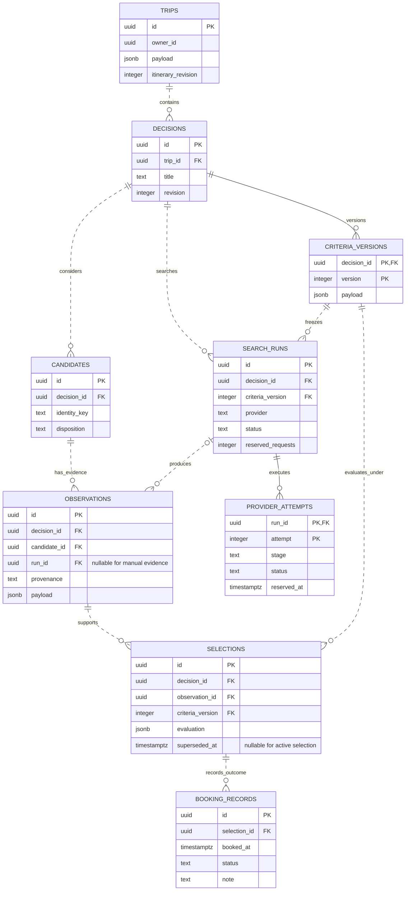
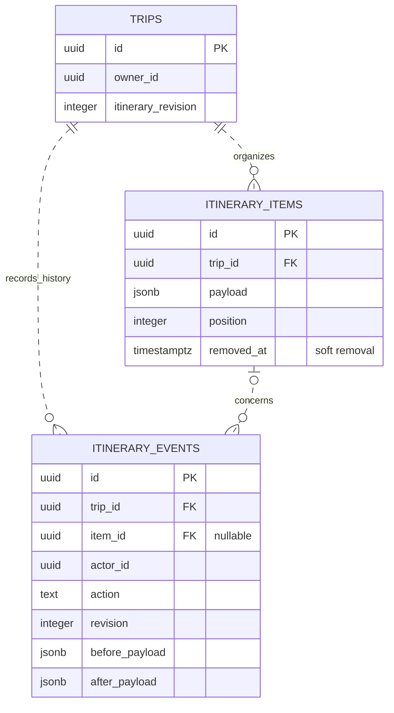
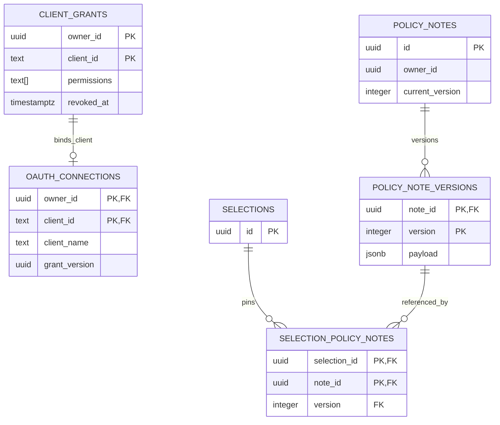
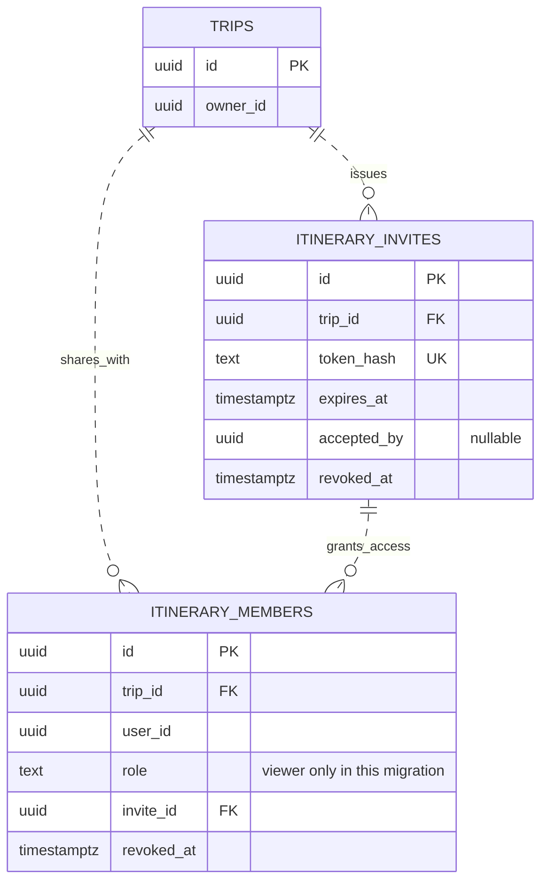
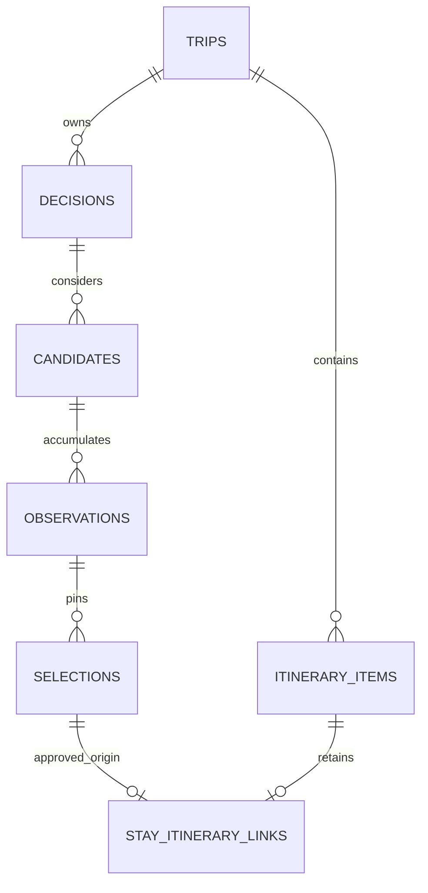
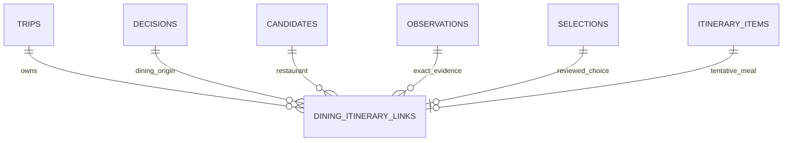
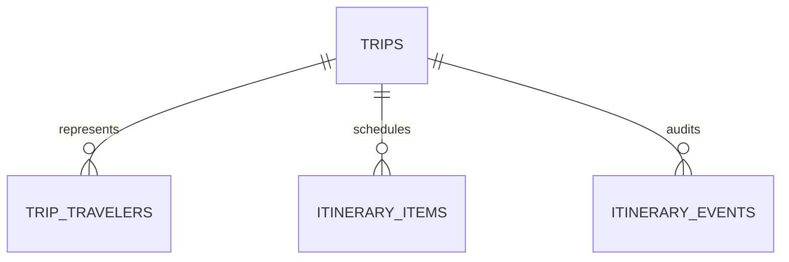
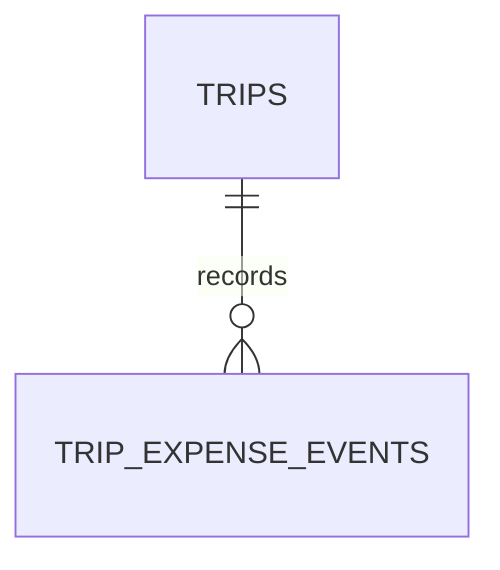

# Database ER diagrams

The detailed ER diagrams preserve the recorded **001–006 baseline**, including viewer sharing; they are not exhaustive diagrams of the latest source schema. See the **007–017 extension index below** for later changes and the feature guides for dated deployment evidence. Start with the [high-level architecture](architecture.md#high-level-architecture), then use the diagrams below for relationships and keys. See [user flows](user-flows.md) for how people use the model.

Entity names match SQL table names, shown in uppercase for readability. Attributes are selected fields, not complete DDL. `PK` marks a primary-key component; `FK` marks a foreign-key component. Solid lines identify a child through its parent key; dashed lines are non-identifying relationships. Both represent enforced foreign keys here; dashed does **not** mean planned. A circle allows zero, a bar means one, and a crow's foot means many. See [Mermaid's notation reference](https://mermaid.js.org/syntax/entityRelationshipDiagram.html).

## Flight research and outcomes

Sources: [migration 001](../migrations/001_initial.sql) and [migration 005](../migrations/005_live_search.sql).

A candidate is the stable flight pair; each observation is a separate dated seller/fare/price report. A run references one immutable criteria version. Manual observations have no run. Composite foreign keys carry `decision_id` alongside candidate, run, observation and criteria references, preventing cross-decision evidence links.

Selections pin exact evidence and evaluation. There can be many historical selections, but a partial unique index allows only one unsuperseded selection per decision. A booking record is a separate user report, not a supplier transaction. The live run reserves request allowance; its attempts preserve stages and uncertain outcomes independently of the offer payload.

## Itinerary and history

Source: [migration 004](../migrations/004_itinerary.sql).

The trip revision serializes plan changes; item ordering and optional local dates/times live in the current plan. Removal hides an item while preserving its row and history. `actor_id` records the authenticated account; it is not a foreign key to a local users table.

The **001–006 baseline diagram** has no persistent item-to-research relationship. Current migrations add `stay_itinerary_links` (013) and `dining_itinerary_links` (014), pinning exact selection, observation and item identities for **explicitly reviewed** sourced stays and meals. Generic flight and other manual drafts remain independent: a copied URL or note is not a durable research link, and later research does not silently update saved items. See [accommodation comparison](accommodation-comparison.md) and [dining comparison](dining-comparison.md).

## Assistant grants and private policy references

Sources: [migration 002](../migrations/002_account_linking.sql) and [migration 003](../migrations/003_policy_notes.sql), with grants introduced in migration 001.

The grant and OAuth connection share `(owner_id, client_id)`. A local-development grant can exist without an OAuth connection. Version rotation invalidates earlier assistant tokens; revocation removes application access without waiting for token expiry.

Private policy notes belong to an account and may be reused across its trips. Selection references pin `(note_id, version)`; they never supply missing quote costs or verify equipment carriage. `current_version` is managed transactionally by the application, rather than enforced through a separate current-version foreign key.

## Account ownership and supporting tables

Supabase Auth manages accounts outside this application schema. `owner_id`, `actor_id`, `requested_by`, and similar UUID fields are verified account references used by the service; the repository's migrations through 012 do **not** add SQL foreign keys to `auth.users`. Migration 010 does add an application `account_profiles` table keyed by the verified account UUID; it is not a replacement for Supabase identity. Ownership checks and direct/assistant session rules remain essential. The browser does not read these tables through the Supabase Data API.

Brevo is configured as Supabase Auth's SMTP relay. It adds no application tables or relationships, so these ER diagrams remain unchanged. SMTP credentials live in Supabase configuration; delivery logs live with the providers. Application invitation tokens/memberships remain in the viewer-sharing tables below, separate from account-confirmation emails. See [account email delivery](account-linking.md#account-email-delivery).

These supporting tables have no application-table foreign keys, so they are listed separately rather than shown with invented relationships:

| Table | Key | Role |
| --- | --- | --- |
| `oauth_consent_requests` | `id` | Bound, expiring authorization request; client/account/redirect data and consumption time |
| `oauth_resource` | `singleton` | One configured resource audience used by the token hook |
| `mutation_requests` | `(owner_id, operation, key)` | Request hash and original response for idempotent retries |
| `app_schema_migrations` | `version` | Migration metadata created by [database.ts](../src/database.ts) |

The 21 October bootstrap fix protects `app_schema_migrations` with RLS and
revocations from PUBLIC/browser roles, including databases already at the current
version. This is deployed behavior; see the [security investigation and
live verification boundary](database-security-2026-10-21.md). It adds no Data API
grants or numbered migration.

The ER diagrams and this table document the original 001–006 schema baseline. Later migrations add comment and profile tables, summarized below; do not treat the original table count as current. JSONB fields hold validated snapshots; this is not the larger [historical schema proposal](spike/design/schema.sql).

## Viewer sharing extension — 14 October 2026 baseline

Source: [migration 006](../migrations/006_itinerary_sharing.sql), deployed with `f6f1670` on 14 October. See [sharing acceptance and limits](itinerary-sharing.md): hosted second-account confirmation, view-only joining and revocation passed with a fictional trip. It adds viewer access; comments, collaborator proposals and approval tables are not part of this migration.

`UK` marks a unique value. Membership is unique by `(trip_id, user_id)`, and the composite invite/trip foreign key keeps access bound to the same trip. The SQL schema permits multiple member rows referencing an invite; the current application redemption rules bind an invitation to one accepting account. The owner remains `trips.owner_id`, not an extra membership row. Further collaboration roles and discussion remain product targets, shown in [user flows](user-flows.md#collaborator-proposal-and-approval--target-flow).

Update the relevant ER diagram when an applied migration changes relationships. Keep local/proposed extensions labelled until deployment and acceptance evidence are recorded.

## Changes since the 001–006 ER baseline (007–018)

The diagrams above intentionally preserve the relationships visible in the 14 October baseline. Consult the SQL migrations for the authoritative current schema; these extensions are recorded here to avoid mistaking the old viewer-only diagram for the present model.

| Migration | Source-level change | Evidence and boundary |
| --- | --- | --- |
| [007 — editors](../migrations/007_itinerary_editors.sql) | Adds `editor` alongside `viewer` in invitation/membership role constraints, retaining legacy viewers. | [Sharing guide](itinerary-sharing.md); a role does not itself grant account ownership. |
| [008 — anonymous links](../migrations/008_itinerary_view_links.sql) | Adds `account`/`link` access modes and read-only constraints; old invitations remain account-bound. | [Sharing guide](itinerary-sharing.md); no anonymous editor access. |
| [009 — comments](../migrations/009_itinerary_comments.sql) | Adds `itinerary_comments` with `trip_id`, optional `(item_id, trip_id)` relationship, author ID/label/role, timestamps and soft deletion. | [Discussion guide](itinerary-comments.md), including dated hosted observations. Comments do not authorize itinerary edits. |
| [010 — profiles](../migrations/010_account_profiles.sql) | Adds `account_profiles`, keyed by external Supabase account UUID, with display name, optional legacy handle, bounded avatar data, revision and timestamp. | [Profile guide](account-profiles.md) documents a 16 October hosted release and recorded schema-version 10 startup; profile names do not grant roles. |
| [011 — lifecycle](../migrations/011_trip_lifecycle.sql) | Archive actor/time, lifecycle review revision, hashed confirmations, deletion/retry guards and independent quota counters. | [Lifecycle guide](trip-lifecycle.md) records retention, migration and acceptance; schema rollback cannot restore deleted content. |
| [012 — research archive](../migrations/012_decision_archive.sql) | Nullable archive actor/time on decisions, plus protected archive/restore events keyed by decision/revision. Existing research remains active and untouched. | [Semantics and rollback constraints](data-semantics-review.md#research-archive-issue-24); no quota or booking changes. |
| [013 — stays](../migrations/013_stay_comparison.sql) | Typed stay decisions and `stay_itinerary_links` pin exact reviewed evidence to an itinerary item. | [Accommodation contract](accommodation-comparison.md); source and recorded hosted evidence are separate. |
| [014 — dining](../migrations/014_dining_comparison.sql) | Typed dining decisions and `dining_itinerary_links` pin exact reviewed evidence to an itinerary item. | [Dining contract](dining-comparison.md); a link is not a restaurant booking. |
| [015 — travelers](../migrations/015_trip_travelers.sql) | Trip-scoped stable traveler UUIDs, names, archive timestamps and traveler lifecycle event types. Item assignments are stored in validated itinerary item payloads. | Deployed. [Traveler UI and privacy](itinerary-web.md#travelers-and-split-plans); [#8](https://github.com/eddieyang-97/trip-planning-engine/issues/8) tracks the real-friend pilot. |
| [016 — expenses](../migrations/016_trip_expenses.sql) | Append-only `trip_expense_events` keyed by (trip, ledger revision), originally limited to GBP pennies, storing payer and exact shares in validated JSON detail. | Deployed and [hosted-verified](itinerary-web.md#trip-expenses) on 16 November 2026. See [expense semantics](data-semantics-review.md). |
| [017 — external flight evidence](../migrations/017_external_flight_evidence.sql) | Extends observation provenance with assistant-sourced evidence, requiring an author, structured source metadata and no native run reference. | [Import workflow](hosted-live-search.md#import-research-from-another-flight-tool) and [semantics](data-semantics-review.md#assistant-sourced-flight-evidence). |
| [018 — expense currencies](../migrations/018_expense_currencies.sql) | Broadens the expense journal currency constraint to three uppercase letters. Application validation uses a [supported currency list and fixed minor-unit precision](../src/expense-split.ts). | Existing GBP rows need no backfill; see [delivery status](implementation.md) for release versus hosted-acceptance evidence. |

Application migrations are applied by [`src/database.ts`](../src/database.ts) and versioned in **`app_schema_migrations`**; the Supabase connector's separate migration history is not necessarily the app's applied migration ledger. Inspect read-only schema metadata if drift is suspected; do not reapply production DDL through the connector without a coordinated approved change. The live Supabase project is not a test database.

Earlier `itinerary_invites` and `itinerary_members` diagram attributes (e.g., “viewer only”) apply to migration 006 **at that time**; read 007–008 for their present constraints. This index does not replace a fresh database schema introspection or claim complete end-to-end acceptance of every workflow.

## Migration 011 - trip lifecycle

See [011_trip_lifecycle.sql](../migrations/011_trip_lifecycle.sql) and the [feature guide](trip-lifecycle.md). Trips gain nullable archive actor/time and a positive lifecycle revision. Mutation receipts gain indexed trip association for content erasure. Hashed `trip_action_confirmations` are bounded by expiry and tied to an existing trip; `trip_deletions` intentionally retains only trip UUID/time with no trip FK. `live_search_usage` intentionally has no search-run FK so deleting evidence does not reset paid-request allowances. RLS denies browser roles. Parent-before-child application locks and explicit FK-ordered deletes preserve graph integrity; no cascade grants authority.

## Migration 013 — accommodation comparison

[013_stay_comparison.sql](../migrations/013_stay_comparison.sql) adds typed `flight`/`stay` decisions (existing records default to flight), current candidate rationale, nullable authenticated observation/reconciliation metadata, and a protected `stay_itinerary_links` relationship. It reuses the existing immutable criteria, observation and selection tables. The link retains exact trip/decision/candidate/observation/selection/item identity and approval-time evidence; a selection links at most one item. Composite foreign keys enforce consistent parents, and RLS plus PUBLIC/anon/authenticated revocations preserve service-only access.

Existing flight payloads and manual items are not rewritten. Lodging source evidence remains owner-private; shared itinerary projections omit the link/snapshot. Archive retains research; permanent trip deletion removes the relationship with the graph. See [semantics and forward recovery](data-semantics-review.md#sourced-accommodation-comparison-issue-9-25-october-2026). PR #36 was merged and deployed, and hosted fictional accommodation writes/read-back exercised this storage path ([Issue #9](https://github.com/eddieyang-97/trip-planning-engine/issues/9)). This is not supplier inventory verification, nor evidence that any future migration is deployed merely because it passes CI.

## Dining extension — migration 014 (deployed, 27 October 2026)

Adds explicit dining decision kind and the service-only RLS-protected relation below, reusing 013 observation/candidate/decision and selection/observation/decision composite keys. Unique item and selection IDs prevent duplicate linked commits; every foreign key cascades within the trip graph. No flight/stay backfill or rewrite.

See [domain semantics](data-semantics-review.md#sourced-dining-comparison-issue-10-27-october-2026), [migration](../migrations/014_dining_comparison.sql) and [delivery status](implementation.md).

## Traveler roster — migration 015

[015_trip_travelers.sql](../migrations/015_trip_travelers.sql) adds `trip_travelers`: each row has a stable UUID, owning `trip_id`, mutable display name and nullable `archived_at`. A traveler is *not* a login account or trip member. Names need not be unique; archiving preserves the UUID and existing itinerary assignments. New assignments to archived travelers are rejected unless already present on the item. An omitted or empty `travelerIds` array means a whole-trip itinerary item. These assignment IDs are in the validated item JSON payload rather than a separate SQL join table; do not mistake them for foreign keys. Traveler lifecycle changes are recorded in `itinerary_events` and advance the itinerary revision.

The application validates assignment IDs against the trip roster. Signed-in members can see permitted assignments, with archived names redacted. Anonymous links omit the roster and assignment IDs. Rows cascade with trip deletion. The table has RLS enabled and direct PUBLIC/anon/authenticated access revoked. The [production schema check](https://github.com/eddieyang-97/trip-planning-engine/issues/72#issuecomment-6913953452) confirmed the table is present with RLS enabled. See the [traveler flow](itinerary-web.md#travelers-and-split-plans) and [PR #71](https://github.com/eddieyang-97/trip-planning-engine/pull/71).

## Trip expense journal — migrations 016 and 018

[016_trip_expenses.sql](../migrations/016_trip_expenses.sql) adds `trip_expense_events` with a composite primary key `(trip_id, revision)`. Each immutable event records an `expense_id`, actor, `recorded`/`corrected`/`voided` action, original currency, positive integer `amount_minor`, validated `detail` JSON (title, paid date, payer ID and exact shares), and timestamp. The current ledger is derived from the newest event per expense, excluding voided entries. The ledger revision is independent of itinerary revisions and is checked on writes under the trip lock with mutation idempotency. The active expense count is capped in the application.

Migration 018 changes the currency constraint in place and the application validates a fixed set of supported currency codes and minor-unit precisions. Balances and suggested repayments are derived separately for each currency; no exchange-rate conversion or recorded repayment occurs. Once an event in another currency exists, recover by shipping a fix that retains currency-aware reads. A rollback to the GBP-only application can mislabel amounts even if all foreign expenses have since been voided. Older web pages get a reload message when their ledger projection contains a foreign currency.

Payer and share traveler UUIDs in `detail` are application-validated references to `trip_travelers`. The deterministic algorithm assigns extra minor units in sorted UUID order, preserving the original paid total. A payer may sit outside the split. Owners may record, correct, void and inspect recent journal events. Signed-in members see current expenses, balances and suggestions. Account-free links, exports and MCP tools omit the ledger. The table has RLS enabled and direct PUBLIC/anon/authenticated access revoked. Trip deletion cascades to the journal. On 16 November 2026, the [production schema check](https://github.com/eddieyang-97/trip-planning-engine/issues/72#issuecomment-6913953452) confirmed migration 016 and the table's effective browser-role restrictions. See the [expense flow and hosted acceptance](itinerary-web.md#trip-expenses), [domain semantics](data-semantics-review.md) and [PR #73](https://github.com/eddieyang-97/trip-planning-engine/pull/73).
