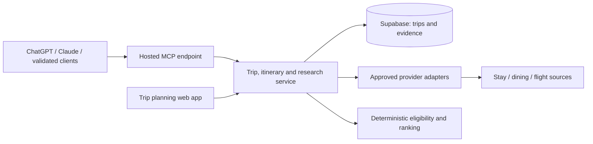

# Trip Planning Workspace — PRD

Version: 0.6 · 15 October 2026 · Status: agreed product direction; requirements and acceptance targets

This file defines product requirements, not verified shipping status; see [implementation.md](implementation.md) for delivery evidence, [architecture.md](architecture.md) for accepted technical direction, and [README.md](README.md) for feature guides. Web and authorized MCP assistants are first-class interfaces to one trip state; their UX can differ. The working name and repository/deployment identifiers stay unchanged.

**Priority correction (15 October):** Accommodation and restaurant options are primary research workflows. A reliable shared itinerary and remembered decisions are the core product. Flights initially establish trip **feasibility** (plausible routes, timing, luggage and transfers), not comprehensive fare optimization. The existing narrow flight pilot and its evidence safeguards remain valid. Deliver useful, independently verified increments; there is no single monolithic v1/MVP gate.

## 1. Product thesis

Create a shared travel workspace that remembers research, shortlisted options, selection rationale, booking conditions and what changed, then maintains one authoritative itinerary for a group. Different trips create different decisions: accommodation configurations, restaurants, transfers, flights and activities.

**Primary job to be done:**

> Help me find and compare places to stay and eat that suit my group, understand their complete known costs and practical trade-offs, remember why I chose or rejected them, and revisit the decision without repeating research.

**Connected itinerary job:**

> Keep everyone's arrivals, lodging, meals, activities, departures, bookings, deadlines and open decisions in one useful plan, without maintaining a separate Google Doc.

**Supporting flight job:**

> Establish whether the trip is reachable with workable flights, bags and transfers; clearly label missing costs, conditions and coverage instead of claiming a complete market search.

The product differentiates on **persistent, assistant-accessible decision context**, not replicating booking-site inventory. The web app provides direct controls and readable mobile plans; connected assistants provide conversational research and edits. The backend owns identity, durable trip state, provenance, constraints, permissions and explainable comparison. Manual and sourced options must work even without supplier APIs. Selection is not a booking; a user-reported confirmation is not automatically provider-verified.

## 2. Audience and problem

The initial organizer plans leisure trips, often for friends. People can have different arrivals, returns, lodging arrangements or activity participation. A represented traveler does not have to create an account. The organizer may use web and authorized assistants under the same verified account; friends should be able to consult a mobile plan without an assistant, including via an explicit revocable anonymous read link if the organizer opts in.

Accommodation alternatives, actual room/bed layouts, cancellation deadlines, restaurant options and menus, flight/transfer conditions, confirmations, chats and a working Google Doc become scattered. Repeat searches lose reasoning and old evidence; selected options can be mistaken for booked ones. A useful shared view should communicate booking status and chosen rationale without leaking private confirmation codes, personal details or internal notes.

These are working hypotheses to test through real trips, not broad validated market claims. Alba, Zermatt, Center Parcs and Flaine provide complementary pilot scenarios.

## 3. Outcomes and validation

Compare real organizer effort with booking websites + an assistant + a shared document. Pilot targets are hypotheses, not claimed benefits.

| Outcome | Acceptance evidence |
|---|---|
| Import, don't rebuild | Migrate Alba itinerary and critical bookings/transfers, flagging uncertain fields for organizer review |
| Compare accommodations | Compare Zermatt stays by whole-party cost, actual beds, location, refundable deposit, cancellation deadline and late check-in |
| Compare restaurants | Save a sourced shortlist with menu, group fit, expected costs including documented service, booking path and rationale |
| Reduce repeat work | On revisiting stay or dining research, see material changes in two minutes without reconstructing the shortlist |
| Support group logistics | A Center Parcs friend can identify activities and their Sunday/Monday return arrangements on a phone |
| Preserve booking integrity | Clearly separate shortlisted, selected, requested, user-reported booked and genuinely verified states |
| Preserve evidence | Display source, observation time, price basis, known mandatory charges and unknowns; never fabricate availability |
| Respect roles | Verify anonymous-link revocation, editor limits, private-field filtering and conflicting edits with real accounts |
| Continue across interfaces | Web and each authorized MCP client see the same saved items and permitted updates |
| Check flight feasibility | Flaine options show viable times and unresolved snowboard/transfer costs within known source coverage |
| Prove adoption | A second organizer can manage a real trip without a parallel working Google Doc |

A deployed API or smoke test does not establish that a complete user journey works. Prioritize demonstrated effort saved, better decisions or avoided logistical mistakes; reduce scope where complexity outstrips value.

### Product learning signals (private pilot)

Keep product-market-fit evidence separate from technical feature acceptance. Establish a lightweight baseline during a few real trips; do **not** set unsupported conversion or retention targets before observing usage. Prefer small, consented pilot feedback and privacy-minimal aggregate counters over broad tracking.

- **First value:** can another organizer create/import a trip and obtain a useful itinerary or stay/dining comparison without coaching? Record whether they abandon or require manual intervention.
- **Return and reuse:** do organizers return to the same trip to revisit research, update a plan, or make another decision instead of rebuilding it elsewhere? Note which repeat tasks actually save effort.
- **Group usefulness:** do invited friends open the shared plan and find their own attendance, accommodation and departure information on a phone without contacting the organizer?
- **Displacement and trust:** does the organizer stop maintaining a parallel planning document, and can members identify unverified prices and booking status correctly? Record confusion or consequential omissions.
- **Qualitative evidence:** capture why people do or do not repeat the workflow; treat a handful of self-selected trips as learning, not proven market demand.

Review these signals after actual Alba, Zermatt, Center Parcs and second-organizer pilot sessions. Promote a feature only if repeat use or meaningful time/decision improvement outweighs ongoing complexity.

## 4. Scope and delivery boundaries

Ship independently useful increments rather than making accommodation and dining dependent on complex collaboration or full flight-search coverage. Current delivery and verification live in [implementation.md](implementation.md).

| Priority / near-term | Later / conditional |
|---|---|
| Trip, itinerary and saved decision state shared by web and authorized MCP | Separate backend LLM; embedded assistant widgets |
| Import/paste existing itineraries or confirmations with review of ambiguous fields | Universal automated extraction from all external sites and inboxes |
| Accommodation comparison: hotels, combinations of rooms, apartments, chalets and entire-place stays; manual/sourced options first | Comprehensive accommodation API inventory, unapproved scraping or automated checkout |
| Restaurant comparison: menus, group fit, price evidence, saved shortlists and real reservation links | Live table inventory and reservation actions without approved access |
| Dated research observations, repeat comparisons and retained selection rationale | Opaque AI-generated fact scores or invented availability |
| Participant-specific travel, lodging and activity assignments | Full passenger/travel-agency servicing |
| Revocable anonymous read-only link and basic signed-in viewer/editor permissions | Voting, synchronous editing, complex proposals/approval and custom roles |
| One-off Apple Calendar .ics exports for individual/all/selected items | Automatic sync or subscriptions |
| Bounded flight-feasibility check with known price/coverage caveats | Comprehensive flights, flexible dates, multi-provider aggregation, fare alerts |
| External booking links and explicitly recorded booking status | Native supplier booking, payments, cancellations or ticket issuance pending explicit integration gates |
| Later trip-aware expense ledger tied to participants and itinerary items | P2P money movement, escrow, direct Splitwise API reliance or automated settlement |

Provider access, display/retention rights and cost determine which live research integrations are viable. Manual accommodation, restaurant and itinerary entries are valuable independently of any external API.

## 5. Core experience

Web and authorized MCP clients share trip IDs, evidence, permissions and revision rules; interface design may differ. The web app does not require an assistant account. Resolve ambiguous trip names using dates and stable IDs, and never guess a travel-account identity.

1. **Create or import.** Start a trip or paste/import an existing itinerary and booking notes; review uncertain dates, amounts, statuses and participant assignments before committing.
2. **Define logistics and decisions.** Represent different traveler arrivals, lodging, activity participation and returns. Save explicit hard constraints, preferences and assumptions for accommodation, restaurants and any flight-feasibility check.
3. **Discover options.** Use approved provider results or manual/sourced links. Show provider coverage, prices and basis, local conditions, observation times and unknowns.
4. **Compare and explain.** Accommodation emphasizes whole-party total cost, beds, location and cancellations; dining emphasizes menu, party fit, price/service and genuine reservation path; flights emphasize viable times, baggage and onward transfer.
5. **Keep reasoning.** Save a shortlist, rejected alternatives and chosen rationale; repeat the search without losing evidence and distinguish genuine comparable changes from source/criteria changes.
6. **Plan and record bookings.** Adding a selected candidate makes a tentative plan, not a booking. Click-out never implies confirmation; record reported bookings separately from independently verified ones.
7. **Share and use.** Show a mobile itinerary with permission-filtered statuses and participant-specific logistics. Support basic sharing and one-off Apple Calendar exports.

For any comparison, answer: Does it fit? What will it cost? Why choose or avoid it? What remains unverified? The detailed flight-specific search and cost rules below remain applicable to the bounded feasibility feature, not mandatory prerequisites for accommodation or dining work.

### Itinerary experience and collaboration

Provide an overview, readable day-by-day items, unscheduled ideas, and separate traveler arrangements for flights, stays, meals, transfers and activities. Preserve unknown fields without fabricating times or bookings.

- Trips are private until explicitly shared. The organizer may enable an **anonymous read-only link**, optionally expiring and always revocable, with a warning that a forwarded link also grants read access.
- Signed-in viewers may read permitted details; signed-in editors may directly edit permitted shared itinerary fields, subject to client write consent, authorization and revision checks. No assistant account is required to use web.
- Share useful booking status and selected-option rationale while restricting codes, personal details, private notes, sensitive research history and access controls using server-side field filtering.
- Track edits with actor, time and revisions. Research changes must not silently change confirmed plans; conflict or revocation must not silently fail.
- Discussion, item proposals and owner approval are **conditional enhancements**, not prerequisites for accommodation research or basic trip editing.
- Export individual, all or selected dated items as a one-off .ics snapshot; automatic sync is out of scope.

Real-user acceptance requires a friend to understand the trip from a phone without a parallel Google Doc. Verify anonymous viewing, editor behavior, private fields and calendar acceptance separately.

## 6. Domain model

Use Trip → Decision → Candidate as the ownership structure for accommodation, restaurant and flight choices. A Decision also owns SearchRuns. Each SearchRun produces observations of candidates; a candidate may be encountered in many runs. Putting SearchRun only beneath Candidate would make run history and partial failures harder to represent correctly.

| Object | Meaning and essential information |
|---|---|
| Trip | Travel-account owner, name, destination, dates, display currency and traveler assumptions; ownership is independent of chat client |
| Decision | Question to resolve, type, lifecycle state, current criteria version, selected candidate and rationale |
| CriteriaVersion | Immutable snapshot of hard constraints, scoring preferences, baggage assumptions and passenger composition |
| Candidate | A stable option within a decision: for flights, a stay/configuration, restaurant/meal option or flight itinerary; user disposition and notes persist across searches |
| SearchRun | Criteria version, source, request time, completion time, outcome, coverage and errors; rerunning produces a new run |
| OfferObservation | Provider- or user-sourced dated observation of a candidate: cost components, party/unit basis, booking terms, any supported availability signal, currency and source; flight fares are a subtype |
| Evidence | Provenance for a fact: provider response, link or manual note; observed time, scope and whether the fact is quoted, calculated or assumed |
| BookingRecord | Separate external booking record with selected option, provenance (reported or verified), paid amount and timestamp |

The organizer foundation adds ItineraryItem to the same trip without requiring a research decision for every manual item. Basic access adds memberships and share links; optional future discussion adds comments and proposals, building on shared activity history:

| Object | Meaning and essential information |
|---|---|
| ItineraryItem | Trip, item type, title, optional local dates/times and time zones, location, links, freeform notes, plan status and revision; optional links to a decision, selected candidate and booking record |
| AccountProfile | Immutable account ID, validated editable display handle, optional avatar reference; profile changes do not change authorization or historical attribution |
| TripMembership | Authenticated account, trip and role: organizer, editor or viewer; invitation and revocation state |\n| ShareLink | Explicit owner-enabled anonymous read-only access, optionally expiring and revocable; private fields excluded |\n| ParticipantPlan | Arrival, return, room and activity assignments for traveler subsets without requiring each traveler to be a member |\n| ImportBatch | Source content, suggested mapped items, ambiguities and explicit organizer review before commit |
| Comment | Author, trip or itinerary-item target, text and timestamps; discussion does not itself change the agreed plan |
| ChangeProposal | Author, proposed addition or target item for edit/removal, proposed values, expected revision for an existing item, pending/accepted/declined status and organizer resolution |
| ActivityEvent | Actor, target, action and time; enough before/after context to explain an accepted proposal or organizer edit |

The initial Trip owner is the organizer. A represented traveler is not automatically a member. Linked itinerary items reference saved research and booking records rather than creating independent copies of those facts. Later searches never automatically replace itinerary choices or recorded bookings. Display booking status from the linked record when present; manual booking reports remain visibly user-reported.

Separate the flight itinerary from its fare offers. The same flights can have different baggage allowances, fare brands, sellers and prices. Never combine a cheap fare from one offer with a baggage entitlement from another.

Candidate disposition is independent of live availability: saved, rejected or selected candidates remain in the record when an offer disappears. A decision may move from researching to selected to booked; reopening it preserves its history. Booking status is user-reported unless independently verified through an authorized source; selection and booking-page clicks are never confirmation.

Store monetary values exactly with currency and explicit units. Store flight instants and relevant IANA time zones, displaying the local date and time at each airport. Preserve source identifiers as well as normalized fields. Provider terms will determine which raw responses and historical facts may be retained and for how long.

## 7. Functional requirements

### Import, accommodation, dining and participants

- Import or paste existing itinerary/booking data as a reviewable proposal, preserving original source links and flagging uncertain date, amount, traveler and booking fields. Avoid duplicates; require confirmation for ambiguous merges.
- Compare accommodations by whole-party known total, precise room/unit and actual beds, taxes/mandatory fees, refundable deposit separately, distance, transport, late check-in, cancellation/refund deadline and source freshness. Never infer that a selected stay is booked.
- Compare restaurants by sourced menu, cuisine, dietary/group fit, meal time, party size, location, costs (including applicable documented service/taxes), atmosphere and actual reservation page. Never invent live table availability.
- Save decision rationale, considered/rejected/shortlisted choices and new dated observations. Lack of a result does not mean unavailable.
- Support participant-specific arrival and return routes, room assignments and activity participation, independent of login.
- Distinguish selected/tentative, booking-requested, user-reported booked and verified confirmation statuses. Permit sharing useful status and reasoning without disclosing booking codes or identities.

### Constraints and feasibility

- Support exact travel dates, allowed airports, passenger count, maximum stops, local time windows and required baggage. Allow a maximum total budget with explicit per-person or party scope.
- Evaluate hard constraints before ranking. A candidate is **eligible**, **ineligible** or **needs verification**. Unknown is not equivalent to passing.
- If required baggage is unpriced, the complete-price budget check remains unknown even when the base fare fits. If known costs already exceed the cap, it fails.
- Return excluded candidates and constraint-failure reasons on request through comparison tools. Never silently relax a constraint to create more results.
- Represent practical dependencies such as late transfer availability and late check-in as explicit manual conditions in v1. They do not become verified merely because a flight search succeeds.
- Changing a constraint or preference creates a new criteria version. Re-evaluation of stored facts is possible, but changes that affect the provider query require another search before claiming current coverage.

### Cost and evidence

- Display base fare, required baggage, known fees, known subtotal and unresolved costs separately. Distinguish quoted amounts, estimates and user-entered figures.
- Show party total and per-person allocation only with clear passenger assumptions. Do not multiply a one-seat quote and imply availability at that fare for the full group.
- Any currency conversion needs a dated rate and a visible converted-estimate label; retain original amounts. A simple v1 may request GBP prices and leave unsupported currencies unranked by price until conversion is available.
- Each price and availability statement must identify its source, time and scope. Terms such as “from” and indicative fares cannot be presented as quotes for the exact requested trip.
- A live search result is an observation, not a guarantee that the offer is still purchasable. Mark freshness using provider-specific policies and explicit expiry when supplied.
- Manual facts need a source link or a user-note label and an entered/observed date. Editing a manual price must not overwrite the historical observation.

### Search and comparison

- A new run preserves prior observations, shortlist and rejection reasons, subject to lawful retention limits. Retrieve this state by authenticated travel account and stable IDs; conversation memory is not the source of truth.
- Classify run outcomes as complete, partial, failed or cancelled; distinguish a completed search with no matching results from failure.
- Retain results from successful source requests when another request fails, while clearly marking incomplete coverage.
- Compare like-for-like offers when calculating price changes: itinerary, passenger count, currency, fare conditions and baggage assumptions must match. Otherwise explain that the basis changed.
- An option absent from a later run is “not returned in this search,” unless the source explicitly confirms unavailability.
- Distinguish changes to the market from changes to criteria or scoring. Price movements, schedule changes and changed baggage conditions must remain inspectable.
- Repeating a search means repeating a versioned query, not reproducing an identical market result.

### Selection and booking

- A decision has at most one active selected candidate in v1. Replacing it records the previous selection and optional reason.
- Selection may proceed with unresolved conditions after those conditions are clearly shown; the product must retain the needs-verification state. It must not relabel the option as fully feasible.
- When the selected offer is stale or has changed, prompt a refresh before external booking, without implying refresh reserves inventory.
- Preserve a recorded booking independently of later search changes. Do not automatically alter booked plans.

### Itinerary foundation and collaboration

- Present a mobile-friendly trip with stays, meals, flights, transfers, activities, notes and unscheduled options, including traveler-specific assignments.
- Allow manual editing and reviewable import without provider integration. Preserve evidence, provenance and unknowns; never auto-mark a selected option booked.
- Store user-reported bookings separately and never let new search observations overwrite them. Flag incompatible research changes for reconciliation instead.
- Make anonymous share links explicitly opt-in, revocable and read-only with server-side field filtering. Signed-in editors can modify permitted shared fields; viewers read only.
- Enforce same identity, permission and revision semantics through web and authorized MCP; unsupported client actions return explicit errors. Record attribution, reject stale writes and enforce revocations.
- Rich comments, proposals and approvals are optional usage-driven increments, not dependencies for accommodation or dining comparisons.

### Account profile and trip member roster

- Provide an **Account** page where a signed-in user can choose, edit and see their public **display ID/handle** and avatar. Support a selected/default avatar and an optional image upload, with accessible fallback initials when no avatar is set.
- Keep the user-facing display ID separate from the **immutable internal account ID** used for authentication, permissions and ownership. Validate handle format and uniqueness. Changing a display ID or avatar must not change access rights, trip IDs or historical attribution.
- Each trip has a **Members** section showing accepted signed-in members with avatar, display ID and role (**organizer, editor, viewer**). It is mobile-readable and distinguishes pending invitations from accepted members. Participants represented in travel plans are not automatically members.
- Member displays reflect current account profiles after changes rather than permanently copied names/avatars. Use a safe fallback label for an incomplete profile.
- Limit member-profile visibility to authorized signed-in members by default. Anonymous read-only shares must not reveal profile/account IDs, emails or the member roster unless an explicit separate sharing setting allows it; profile changes never elevate permissions or undo revocation.

### Booking integration: progressive levels

The product should support bookings in stages, separately by supplier and travel category. These stages are **targets**, not claims of provider approval, live inventory, or features already deployed:

1. **External booking handoff (first):** show a genuine supplier or reservation link, source, observed terms and estimated total, then open checkout outside our app. Let the organizer manually record the confirmation, amount paid, date, booking policy and reference in a private field. Opening the link never marks an item booked; unknown availability remains unknown.
2. **Approved API booking (conditional):** only with contracted provider access, explicit booking consent, real-time revalidation of price/availability/terms, any required passenger or guest details, a reliable create/confirm response and an accessible booking record. Do not mark success on an HTTP acknowledgement alone; resolve uncertain/timeout outcomes through supplier retrieval before retrying.
3. **Full post-booking servicing (much later):** payment collection, modifications, cancellations, refunds, disputes, supplier support, incident response and reconciliation. These require durable support and compliance capacity; they are not automatic consequences of implementing stage 2.

| Category | Feasible provider direction to investigate | Main barriers and rollout preference |
|---|---|---|
| **Accommodation — preferred first native-booking candidate** | Booking.com [Demand API](https://developers.booking.com/demand/docs/getting-started/overview) offers search/redirect and supported order-preview/create/management flows; Expedia [Rapid API](https://developers.expediagroup.com/rapid/setup) is another partnership path. | Partner eligibility, contractual terms, full-party room/bed allocation, re-priced final totals, taxes/deposits, cancellation deadlines, payments and after-sales support. Begin with sourced comparisons and external handoff; pilot one approved booking partner only if commercial access and servicing are feasible. |
| **Restaurants — simpler reservation transaction, fragmented coverage** | OpenTable [Online Booking/Consumer API](https://docs.opentable.com/) documents reservation availability and creation for contracted partners. Other restaurant platforms and direct links need separate access arrangements. | Different restaurants use different systems; party size, deposits/card guarantees, cancellation/no-show policies and supported seating differ. Prioritize valid reservation pages, manual confirmation and approved availability feeds; enable in-app reservation creation only for covered restaurants with verified confirmation. |
| **Flights — most demanding; defer ticketing** | Duffel [Orders API](https://duffel.com/docs/api/orders) demonstrates offer-to-airline-order flows under applicable access arrangements. | Fresh fare repricing, complete traveler names/document requirements, baggage/ancillaries, ticket issuance, schedule changes, airline servicing, cancellations, refunds, chargebacks and legal obligations. Keep flights focused on feasibility and external ticket checkout; do not promise native issuance in an early release. |

**Requirements for any booking provider:** document credentials/partner approval, covered inventory, live-versus-indicative data, cached-data rights, payment model and merchant of record, consumer disclosures, cancellation/refund responsibilities, commissions, reporting, webhook or polling support, request limits and supplier support expectations. Treat a successful partner sandbox exercise as technical feasibility, not production entitlement. Review applicable UK consumer/package-travel, data protection and payment requirements before selling or combining services; obtain professional advice for the chosen business model. Do not store card numbers in our application.

**Booking state and authority:** model a BookingIntent (who requests what), BookingAttempt (provider correlation/idempotency key, request/response status) and BookingRecord (supplier reference, verified or user-reported provenance, actual price, currency, conditions, relevant dates and private details). A user must explicitly authorize each supplier-side action and review refreshed final terms. The only valid confirmations are a verified supplier result or a clearly labeled user report. Timed-out creates are **pending verification**, not failed/no-booking or safe-to-retry by default. Prevent duplicate bookings, preserve audit history, isolate private confirmations from anonymous/editor views, and reconcile a booking into the itinerary without silently creating an expense or changing another participant's schedule. Supplier-initiated changes and refunds must be represented separately from research observations.

**Booking acceptance gates:** validate reprice/offer expiry; party-wide accommodation configuration, taxes, deposit and cancellation disclosure; dining date, time, party size and any guarantee; flight-specific fare/baggage caveats; explicit consent; idempotent create and timeout recovery; booking retrieval, cancellation/error states and revocation/privacy. Test the provider's real production permissions and realistic after-sales path before enabling a checkout button. Any unsupported stage falls back cleanly to handoff/manual reporting.

### Trip expenses and settlement ledger (later deliverable)

Build a **trip-aware** cost-sharing ledger rather than a generic Splitwise clone: link expenses to existing trip members/represented participants and optional bookings or itinerary items, so split groups, different attendance and different return dates are reflected correctly. This is a later product increment **after** itinerary reliability, stay/dining comparisons and booking handoff. No supplier payment, person-to-person transfer, automatic card charge, debt collection or escrow is included in the initial expense feature.

- **Record an expense:** title, category, payer, date, original amount and currency, optional source receipt/link, itinerary/booking link, notes and participants included in the split. Record **actual paid** amounts separately from estimated or selected itinerary costs. A reservation confirmation does not automatically become an expense.
- **Allocate fairly:** equal split across selected participants, custom fixed amounts, percentages or weighted shares; partial participation (e.g. only six people attended an activity) is explicit. Allow reimbursement owed to someone who is represented but not a registered account. Validate that participant shares sum exactly to the source amount with deterministic minor-unit rounding.
- **Currencies:** retain original amount/currency; optionally display home-currency estimates with dated explicit FX rates and chosen conversion basis. Do not silently mix currencies or assert an actual FX-paid amount from an estimate. Settlement suggestions must specify the currency and avoid invalid cross-currency netting.
- **Balances and settlement:** show how much each person paid and owes, net balances per trip/currency, suggested few-transfer settlements and manually recorded external repayments (including partial). Repayment is **reported**, not a payment executed/verified by our app. Clear separation between shared proposed costs, confirmed expenses and settled amounts.
- **Accuracy and governance:** store immutable expense/payment event history or reversible adjustment records, actor, timestamp and revisions; support corrections without silently rewriting another member's balance. Apply organizer/editor permissions and privacy filtering; anonymous itinerary viewers do not see private expense details by default. Export a human-readable ledger and CSV for reconciliation; receipts are optional and access-controlled.
- **API independence:** own our ledger. Splitwise's [self-service API terms](https://github.com/splitwise/api-docs/blob/main/splitwise.yaml) restrict commercial use and competing implementations; do not build the feature on that API without a separately negotiated license.

**Example acceptance:** Center Parcs has ten travelers, one payer for a £2,000 lodge (ten equal £200 shares), and another payer for a £240 activity attended by six (six £40 shares). A seventh nonattendee owes no share for that activity. The product computes consistent balances, suggests settlement transfers, and records a partial repayment without creating a payment or mutating booked itinerary items. A refund or edited expense is auditable and balances recompute correctly. Validate unequal/custom shares, minor-unit rounding, two currencies, invitation/participant separation, permissions and concurrent edits before calling the expense ledger accepted.

### Map presentation and pin semantics

- Use consistent map-pin colors by **location type** throughout maps, legends and itinerary cards: accommodation = indigo (`#6366F1`); restaurants/cafés/bars = amber (`#F59E0B`); activities/attractions = green (`#16A34A`); transport hubs/pickup points = blue (`#0284C7`).
- Pair each category color with a distinct recognizable icon and accessible text label; never rely on color alone to identify a pin. Provide a clear legend and sufficient marker/icon contrast.
- Highlight a selected or focused pin using size, outline or similar emphasis **without changing its category color**. For comparisons within one category (such as several accommodations), use the same category color across candidates and visually emphasize the selected one.
- Show booking/confirmation state separately from category via an icon or text badge (for example a checkmark for confirmed); color must not simultaneously mean location type and reservation status. Preserve tentative, requested, user-reported booked and externally verified distinctions.
- Apply the same category, selection and status conventions to web maps, linked itinerary entries and accessible interactions. This is a presentation requirement, not a new provider or mapping integration commitment.

### Calendar export

- Support an individual itinerary item, the whole itinerary and a selected subset through one shared .ics export implementation. All and selection use the same dialog: eligible dated items start selected, with Select all, Deselect all and an explicit selected count. Export is disabled for an empty selection.
- Target Apple Calendar on iPhone/iPad for initial acceptance. Mac-specific UI or testing is not required for this slice.
- Export a snapshot of saved itinerary items; later edits do not update imported events. Explain that repeat imports may produce duplicates. Subscription feeds, background updates and direct Apple account writes are deferred.
- Preserve titles, locations, safe source links, practical notes and tentative/reported-booked labels. Respect the reader's existing trip access; export must not expose owner-only booking notes, research or history through a shared view. Exclude private booking notes by default.
- Preserve actual instants for timed events, including flights whose departure and arrival use different time zones. Never silently use the exporting device's time zone for an unknown itinerary zone. Missing information needed for an accurate export must be resolved or the item excluded with an explanation.
- Represent date-only items as all-day events, hotel nights through checkout with the calendar's exclusive end-date convention, and known cross-midnight ends correctly. Do not invent a duration where an end is unknown.
- Keep undated items visible in the selection dialog with a reason they cannot be exported; do not invent dates. Show excluded-item counts before exporting, and leave the saved itinerary and its revision unchanged.
- Validate the hosted browser-to-Calendar flow on a real iPhone/iPad with one item, all eligible items and a noncontiguous subset. Check event count, text, local times and time zones, all-day stay boundaries, missing schedule fields and private-field exclusion. The successful local probe is feasibility evidence, not delivery of this feature; see [delivery status](implementation.md) and [probe evidence](apple-calendar-probe.md).

## 8. Comparison and ranking approach

Apply hard constraints first. Classify candidates eligible, ineligible or needs verification; unknown facts never silently count as compliant, and missing costs must not make an incomplete option seem cheapest.

Prefer transparent side-by-side trade-offs to an opaque aggregate score. Accommodation comparisons cover whole-party price, actual bed configuration, location and cancellation/check-in terms. Restaurant comparisons cover menu/group/dietary fit, known cost including documented service, atmosphere, location and booking pathway. Claim live availability only with approved evidence.

Where justified, a deterministic score may use `score = 100 × Σ(weight × utility) / Σ(weight)`. Utilities must be 0–1 with fixed, explained anchors per criteria version; missing inputs make the score provisional or omitted, never silently reweighted. Keep old evidence distinguishable from new searches and changed preferences.

The existing bounded **flight** scoring settings remain off = 0, low = 1, medium = 2, high = 3, with defaults cost = medium, timing = off, duration = medium, stops = low. Enable timing only with explicit preferred windows. Flight comparisons provide an honest feasibility shortlist, not comprehensive market-wide optimization.

## 9. Acceptance scenarios

The primary product tests use actual planning cases:

| Case | Required behavior |
|---|---|
| Alba, 13–15 Nov 2026 | Import existing itinerary, preserve separate flight groups, transfers, booked dining and uncertain confirmation details without manually rebuilding |
| Zermatt, 14–18 Jan 2027 | Compare competing stays with full group price, actual beds, location and cancellation deadlines; retain alternatives and rationale |
| Center Parcs, 27–30 Nov 2026 | Preserve separate Sunday/Monday return groups and activity participation; friends see the right plan on mobile |
| Restaurant options | Compare a sourced shortlist by party fit, menu, expected cost/service and authentic booking path; revisiting retains earlier decisions |

These are acceptance targets, not claims of shipped functionality.

### Flaine — bounded flight-feasibility test

The supporting flight slice is Flaine, 18–20 December 2026. The user confirmed the year, four travelers, bringing a snowboard and all London airports. Treat four adults and one snowboard as explicit test assumptions until ages and equipment quantity are confirmed.

Historical context recovered from the existing “Flaine Trip” conversation:

- An easyJet option was discussed as Friday LGW 20:05 → GVA 22:35, returning Sunday GVA 20:45 → LGW 21:25.
- The conversation described a screenshot price of ¥1,055 and an estimated £119 per person return, before extras. The source currency and conversion are unverified: the ¥ symbol alone does not identify JPY versus CNY. Exclude this amount from numeric fare fixtures and ranking until the original currency, price basis and dated conversion are verified.
- A SWISS alternative from Heathrow was discussed. An advertised route-level “from” price had been incorrectly useful as a comparison and was later identified as not an exact-date quote.
- Bringing a snowboard versus renting could materially change the cost comparison.
- Friday arrival implied a late onward transfer and accommodation check-in after midnight. Sunday timing needed to preserve useful ski time while allowing the return transfer and airport buffer.

These are historical conversation references, not independently verified current schedules, fares, baggage rules or transfer commitments. The PRD uses them as test inputs. Exact fares and policies must be re-established by a live source or explicitly retained as historical/manual examples.

Acceptance setup: compare all London airports (LHR, LGW, LCY, LTN, STN and SEN) to Geneva for the confirmed dates and four travelers, including a snowboard. Prefer an after-work Friday departure and useful Sunday ski time; exact time boundaries, other luggage and budget remain unset until supplied. Geneva, economy, four adults and one snowboard are labeled test assumptions. A “rent equipment” scenario is an optional separate criteria version and must not replace the confirmed bring-snowboard brief.

| Acceptance test | Expected behavior |
|---|---|
| Enter the trip and flight decision | Dates, passenger assumptions, local time windows, baggage and preferences are visible before searching |
| Run a real provider query | Source and coverage are shown; actual observations are distinguishable from seeded historical examples |
| Validate low-cost-carrier baggage coverage | Test easyJet LGW–GVA for the confirmed dates and four travelers; record whether the source returns exact-trip offers, fare-specific baggage allowance and snowboard availability/pricing for each direction. Distinguish unsupported fields from genuine no-results; unknown equipment costs prevent a complete-cost claim |
| Source misses the easyJet option | Tool result discloses coverage limits; organizer can save a manual candidate through the assistant with its source and historical status |
| Compare a low base fare with a higher baggage-inclusive fare | Comparison uses matching passenger and baggage assumptions; missing equipment fees remain unresolved |
| Supply a route-level SWISS “from” price | It cannot appear as an exact-date, bookable quote or enter a complete-cost ranking |
| Find an arrival near 22:35 Friday | Late transfer and next-day check-in are explicit conditions; no fabricated reservation availability |
| Evaluate Sunday options | Show the return schedule and a user-entered transfer/buffer assumption; do not claim a guaranteed last ski time |
| Reject an inconvenient option, then repeat the search | Rejection reason persists when the same itinerary returns |
| Re-run after a price or fare-condition change | New observation is saved, differences are explained and unlike offers are not presented as a simple price movement |
| Repeat search returns no selected offer | Selection persists and is labeled not returned; it is not silently deleted or automatically declared sold out |
| Provider fails | Failure is visible, historical results retain their original timestamps and retry is available |
| Select and book externally | Selection and user-reported booking remain separate; external click-out does not imply a booking |

The bounded flight slice passes when supported clients expose plausible schedules or honest coverage gaps, preserve a selection and disclose baggage/transfer uncertainty. Exact four-person quotes, snowboard prices and all-airport coverage are separate verification requirements when supported, not assumptions. Create the trip in one surface, retrieve the same persisted decision in another, and repeat a search without re-entering criteria. Make a manual itinerary edit in the web app and retrieve it through MCP; make another through MCP and retrieve it in the web app. Ending a conversation or browser session must not lose saved data. Verify retry deduplication, pending-run recovery, stale-revision handling and isolation between separate accounts on both surfaces. Muse joins acceptance testing only after compatibility is established. Use real integration checks plus controlled fixtures; future fares are not fixed test expectations.

### Itinerary and collaboration acceptance scenario

The organizer uses the same Flaine trip to assemble flights, accommodation, Friday and Sunday transfers, ski activities and practical notes. Entries may be manual; this scenario does not depend on adding hotel or activity providers.

| Acceptance test | Expected behavior |
|---|---|
| Assemble the complete weekend | A readable day-by-day itinerary shows the trip overview, local times, locations, links and notes; missing times and unresolved transfer/check-in conditions remain explicit |
| Add a selected flight and manually entered accommodation | The flight remains tentative until a booking is recorded; manually reported bookings are labelled; research evidence is accessible from the linked item |
| Invite a friend who has no assistant account | The friend signs in through a normal web link and can open the private itinerary on a phone with the assigned role |
| Set account display ID and avatar | Account page saves and displays the chosen handle/avatar, with a fallback; underlying account identity remains unchanged |
| View trip members | The trip shows accepted members with avatar, handle and organizer/editor/viewer role; invitations are separate; anonymous read shares do not expose member profiles |
| Change a member's profile | Display ID/avatar changes appear in trip member lists across authorized clients without changing permissions or losing edit history |
| Comment on the late Friday transfer | The discussion appears on that transfer and retains author and time; the agreed transfer is unchanged |
| Propose an earlier flight or a new activity | The proposal is pending and visible in context; it does not replace the plan until the organizer accepts it |
| Accept or decline a proposal | The decision and actors are recorded; acceptance updates the relevant plan item, while decline leaves the agreed plan unchanged |
| The item changes before proposal acceptance | Acceptance requires review against the latest item; no newer organizer edit is silently overwritten |
| Change the plan through web or MCP | Retrieving the trip in the other surface shows the same items, discussion and proposal outcomes |
| A repeat search changes a fare or research selection | Bookings persist; research changes are visible and selection changes require explicit reconciliation with the itinerary |
| Revoke a member or attempt access from another account | Revoked and nonmember accounts cannot retrieve the private trip through web or MCP; viewers cannot write comments or proposals |
| Use the trip without a parallel Google Doc | The organizer can maintain the full plan and friends can review, discuss and propose changes entirely within the shared itinerary |
| Export one item to Apple Calendar | The item action produces one event with the saved schedule and accessible details; the real iPhone/iPad import succeeds |
| Export all or a selected subset | One dialog defaults to all eligible dated items; deselecting items produces exactly the chosen events, with exclusions explained and no itinerary write |
| Export a flight and a date-only stay | Departure/arrival instants respect their recorded zones; hotel nights end at checkout using an exclusive all-day end; unknown dates, zones or durations are not guessed |
| Edit an item after exporting or import again | The export is visibly a snapshot; no automatic calendar update is promised and duplicate risk is explained |

The organizer foundation must pass itinerary assembly, explicit booking labels and web/MCP state continuity. Basic sharing passes when friends can understand the correct trip on mobile and editors' permitted changes work without maintaining a Google Doc. Complex proposals and approvals require separate usage-driven validation. Verify one real friend collaboration session, role enforcement, revocation and conflicting edits, as well as web/MCP state continuity.

### Persistent web sign-in

- A user who signs into the web app should normally remain signed in after navigating between the Account and Itinerary pages, closing a tab, and restarting the browser on the **same device and browser profile**, until explicit sign-out, expiry/revocation of the refresh session, or cleared browser storage. Do not promise a permanent or cross-device login.
- Reuse the existing Supabase Auth session persistence and automatic access-token refresh. The account and itinerary web clients currently supply `sessionStorage` despite `persistSession: true`; adopt a shared persistent browser-storage strategy (for the existing clients, `localStorage` with the same storage key) or a reviewed secure cookie-based alternative. Avoid storing passwords or extending short-lived access-token lifetimes to achieve persistence.
- An explicit sign-out must clear the local session and remove access to private itinerary/account data from that browser. Handle expired, revoked, malformed or missing sessions by returning to sign-in without leaking private data. Keep protected APIs backed by server-verified credentials; never trust display IDs, browser data or a stale token as authorization.
- Account web sign-in and the separately granted MCP/OAuth client connection are different session lifecycles. Persistence or sign-out of one must not falsely claim to authorize or revoke the other; provide explicit client-connection revocation controls.
- Treat browser storage as sensitive: maintain XSS defenses, CSP and appropriate token-handling hygiene, and document the security trade-off of persistent local storage. Users on shared devices can sign out; private/incognito or aggressively cleared browser storage may not retain a session.

### Persistent sign-in acceptance

| Test | Expected behavior |
|---|---|
| Sign in and navigate | One sign-in works across Account and Itinerary pages within the same browser profile |
| Close tab and restart browser | On returning to either page, the current account and trips load without a new sign-in while the refresh session remains valid and browser data is retained |
| Access token expires | Automatic refresh allows continued authenticated use without a visible login prompt; the backend still validates requests |
| Explicit sign-out | The local web session is cleared and protected pages/API calls require sign-in again, including after browser restart |
| Session revoked/expired or browser storage cleared | No private content is shown; the app safely prompts for a new sign-in |
| MCP client connected separately | Website persistence does not silently grant client permissions; web logout does not falsely report that an independent MCP/OAuth grant has been revoked |

## 10. Quality and operating requirements

- Authenticate each web and MCP request and authorize access to the requested trip. Resolve identity from verified credentials, never a browser- or model-supplied user ID. Verify direct web account sessions and link each supported assistant client to the same travel account through a tested OAuth flow. Keep provider credentials on the server and verify isolation using separate accounts on both surfaces.
- Minimize collected data: basic research does not require passports, payment details or full legal identities. Imported confirmations, if supported, need explicit consent and restricted field-level disclosure.
- Return concise structured data plus readable text through MCP and present the same facts through web controls, with explicit status labels, source references and timestamps. Assistant workflows must not depend on client-specific widgets. Keep the web app, comparisons and sign-in pages accessible on phones, keyboards and screen readers.
- Persist pending search state and expose status retrieval through get_search_run. Bound provider timeouts and retries. Use idempotency keys for paid search starts and mutations; repeat delivery of the same request must not duplicate charges or records. Protect criteria and selection updates with expected revisions to prevent silent overwrites across clients.
- Track provider request count, cost, latency, errors and search completion, plus client connection failures, tool-call failures and duplicate retries. Treat provider text as untrusted data; the server enforces permissions, budgets and constraints independently of assistant instructions.
- The existing narrow live pilot has explicit [request ceilings](hosted-live-search.md#persistence-cost-and-recovery): three requests/run, two runs/owner/day, four globally/day and twenty globally/30 days. These owner/global reservations do not establish a full-product per-trip allowance. Before expanding coverage, cost one all-London-airports search, a repeat search and bounded retries, including airport fan-out, repricing and baggage calls; set the target searches-per-trip allowance and maximum provider cost per trip. Publish those broader limits when verified. If repeat use exceeds the viable budget, change provider, allowance or scope before expansion. Display reached limits; do not substitute invented results.
- Deleting a trip removes its associated private records according to a documented retention policy. Provider restrictions may require earlier evidence expiry.
- Apply membership, anonymous-link and field-level authorization to every web and MCP read/write, history and linked evidence. Invitations, memberships and share links must be separately revocable; display useful booking status without exposing private references or traveler identities.
- Make the itinerary and collaboration controls usable on phones, keyboards and screen readers. Show local date/time context for overnight transfers and stays, including travel across time zones. Protect itinerary writes and proposal resolutions with expected revisions and idempotency where retrying could duplicate actions.

### Reversible iteration and AI-assisted development baseline

Optimize for **learning speed and safe change**, not speculative capacity. AI assistance can lower coding effort but does not eliminate live-data migration, authorization, third-party integration or customer cutover risk. Keep the initial web/MCP/application service as a **modular monolith** with explicit domain, authorization, persistence and supplier-adapter boundaries; do not introduce microservices merely for hypothetical scale.

- **Version-controlled schema changes:** maintain reviewable, ordered migrations for all persisted changes. Prefer additive/expand-and-contract rollouts for consequential schema, identity and API changes: introduce new fields, migrate/backfill and validate, then remove old fields only after compatible readers and historical data are accounted for. Document how to recover if a migration cannot be reversed safely; a code rollback does not automatically restore changed data.
- **Compatibility and safe cutover:** preserve stable IDs, ownership/role meaning, booking/expense provenance and versioned contracts across web, MCP and previously saved trips. For high-risk changes, define compatibility window, backfill/validation, limited rollout, failure signals and rollback or forward-recovery path before release. Avoid rewriting all existing users' state in a single untested deployment.
- **Proportionate automated quality gate:** require TypeScript/type checks and the existing automated test suite for each material code change. Add targeted regression/integration tests for the behavior changed, especially multi-account isolation, invitation/revocation, conflicting writes, booking status, expense/FX/rounding once implemented, imports and shared web↔MCP state. Generated code must meet the same test/verification bar as manually written code; a passing build alone is not end-to-end user acceptance.
- **Incremental rollout:** use small cohorts or a kill switch for risky provider-powered features and maintain traceable release evidence. Monitor errors, permission failures, costs and data anomalies after rollout; disable or revert a feature without losing established itinerary/booking records. Prefer measurable improvements and controlled migration over an all-at-once architectural rewrite.
- **Scope discipline:** automated safeguards should be lightweight at private-pilot scale. Do not mandate elaborate release committees, full enterprise SLOs, distributed infrastructure or a permanent test environment until demonstrated risk or traffic warrants them.

This is a **now** engineering baseline for correctness, maintainability and change safety—not a request to redesign current infrastructure. Formal scale targets remain the separate public-beta gate below.

### Staged non-functional requirements and scale readiness

Treat non-functional requirements (NFRs) as **stage-specific, testable obligations**, not an invitation to prematurely rebuild the current Render + Supabase deployment. Minimum safety and correctness apply immediately; a formal **Scale Readiness / NFR Review** is an explicit **gate before opening a public beta or materially increasing traffic**. Review findings become measured targets, owners, remediation priorities and test evidence in a separate living operational checklist or NFR specification. This PRD sets the required dimensions and gates, not arbitrary performance targets before real traffic characteristics are known.

| Dimension | Minimum safeguards now | Formal public-beta readiness review |
|---|---|---|
| **Performance and user experience** | Usable mobile itinerary, bounded operations/timeouts, no blocking regressions to sign-in, itinerary or map | Measure representative phone page load and map performance plus p50/p95 API latency under realistic read, write and search mixes; choose explicit SLOs and regression budgets |
| **Reliability and recovery** | Handle source timeouts, partial failures, stale sessions, retries, provider limits and obvious downtime without invented results or duplicate writes; confirm database backups are available | Define availability SLO, alerting, backup schedule/retention, restore test, recovery time objective (RTO) and recovery point objective (RPO); rehearse incident and dependency failure responses |
| **Scalability and capacity** | Bound provider fan-out and API usage, paginate large records, cap requests and handle basic concurrency | Model expected active trips, members, simultaneous users, storage, query volume and third-party quotas; load test concurrency, expensive queries, database connections and rate limits; document capacity headroom and bottlenecks |
| **Security and identity** | Authenticate every protected request; enforce trip/role/field isolation, refresh/revocation, safe sharing and current CSP/XSS protections; protect secrets | Threat-model public sharing, upload paths, account recovery and APIs; automate dependency/security checks, validate isolation with multiple identities, review abuse prevention and incident escalation |
| **Data integrity and auditability** | Expected revisions, idempotent mutations, verified booking statuses and accurate expense math where implemented; preserve authors and sources | Test conflicting edits, retries, replay, data migrations, backup-restore correctness and supplier failures; set retention and reconciliation expectations with traceable audit events |
| **Privacy, compliance and accessibility** | Collect minimum personal data, filter private confirmation/account details from anonymous views, support accessible controls | Review UK GDPR/privacy notices, retention/deletion and data-subject processes, accessible mobile/keyboard/screen-reader flows and any required accessibility standard targets |
| **Observability and unit economics** | Structured, privacy-conscious application errors, basic health visibility and provider request/cost ceilings | Define dashboards and alert thresholds for latency, failure rates, provider costs, sign-in failures, job backlog and spend; measure cost per active trip/search and forecast budgets at projected adoption |

**Stage gates and exit evidence:**

1. **Now / private pilot (non-negotiable):** authentication and per-trip authorization; no leaked booking references; safe conflict/idempotency handling; usable backups/restore path; provider cost limits and failures disclosed. Fix correctness/security gaps when found instead of deferring them as scalability work.
2. **Before public beta / meaningful user growth:** write a dated NFR checklist with workload assumptions, service-level indicators/objectives (SLIs/SLOs), measurable p95 page/API targets, concurrent-use load tests, restored-backup proof, RTO/RPO, security and accessibility checks, monitoring/incident owner, expected infrastructure/API spend and documented outstanding risks. Test against expected usage plus a reasonable burst. Approval requires evidence or an explicit risk decision—do not label an unmeasured goal achieved.
3. **Before enabling in-app reservations or money movement:** increase rigor for booking idempotency, durable supplier confirmation/reconciliation, failure recovery, audit logs, operational support, regulatory and payment-data review, incident response and refund/dispute responsibilities. Do not launch a payment or ticketing flow merely because baseline public-beta checks pass.
4. **At each expansion:** watch actual error rates, latency, query behavior, external quotas and unit cost; introduce connection pooling, caches, background workers, queues or additional hosting only after a measured bottleneck and an explained benefit. Re-run relevant readiness checks on architectural changes.

The Scale Readiness review is **not a prerequisite for the next small accommodation, restaurant or itinerary experiments** as long as the immediate safeguards hold. It is a release gate for a public beta, large scale-up or additional high-consequence booking/payment operations. Maintain verification results in delivery/operations documentation instead of presenting planned targets as shipped capabilities.

## 11. Architecture direction and spike brief

The product has two first-class entry points: the web app and a hosted HTTPS MCP endpoint. ChatGPT, Claude and other validated clients call MCP tools; they do not host our server. Both entry points call the same application service for trips, itinerary items, research and, at the collaboration milestone, discussion and proposals. The service owns criteria, provider queries, normalization, evidence, deterministic ranking and permission checks. Direct web sessions and authorized assistant clients use their appropriate authentication paths; neither bypasses the shared authorization rules. Client conversation and presentation remain separate from backend authority and durable state.

The selected initial architecture is one Render service for the web app, hosted MCP endpoint and application logic, with Supabase for Postgres and account identity. Use the approved free tiers for the prototype; no paid upgrade is authorized. Track deployment and acceptance status in the implementation documents. Keep web assets and account pages on the initial service where practical; add another host only for a demonstrated need. Validate real-account web sessions, remote MCP transport, OAuth, request duration, pending-run recovery and cost. Add a separate worker only when measured search behavior requires it; never rely on work continuing after a hosting request has ended. Web, MCP, application logic and provider adapters initially share one deployment.

Initial tool contract: list_trips, create_trip and get_trip retrieve durable context; create_decision and update_decision_criteria manage versioned requirements; start_search and get_search_run manage live queries; compare_candidates and compare_search_runs expose trade-offs and changes; save_candidate and set_candidate_disposition support manual evidence, saving, rejection and restoration; select_candidate and record_booking record distinct outcomes. Each tool needs validated inputs, typed outputs, explicit effects and bounded results. Return stable IDs, source references, observation times, completeness and verification status. Keep full evidence retrievable without returning every historical record on each call.

The organizer foundation exposes itinerary management, saved research and the existing bounded flight tools through web and MCP. Prioritize import review, stay/dining candidates and participant logistics; extend discussion and proposals only when usage supports them. Define exact tool names and schemas during milestone design. Web and MCP must reference the same item IDs and revisions; neither surface requires a separate backend LLM for these workflows.

The technical/product spike and remaining validation must:

1. Inspect Ripwords/ai-trip, jivanb7/trip-planner, Prot10/MyTripPlanner and seanmorley15/AdventureLog, plus stronger relevant projects discovered during research. Compare architecture, UX, data model, live sources, collaboration, deployment, maintenance and actual licenses.
2. Verify current flight, hotel, places, restaurant-reservation and routing providers using primary documentation. Record access requirements, pricing, free tiers, affiliate obligations and whether results are indicative, live, repriceable or actually bookable. Treat permission to cache, retain and redisplay observations for dated evidence and repeat-search comparison as a go/no-go criterion before committing to the provider-dependent data architecture. Record permitted fields, retention windows, expiry/deletion rules, attribution and display restrictions. If the core continuity workflow is prohibited, select another provider or explicitly rescope; do not assume storing a normalized copy avoids the restriction. Prioritize the stay and dining validation paths; keep flight-provider work bounded to feasibility.
3. Prove whether a reachable provider serves the first route, relevant carriers, exact passenger counts and needed fare/baggage fields. Specifically test easyJet LGW–GVA for the confirmed Flaine dates and four travelers, including fare-specific baggage allowance and snowboard availability/pricing in each direction. Distinguish unsupported carrier/ancillary coverage from a completed search returning no offers. Capture reproducible capability evidence without assuming a particular future fare must exist. Document gaps and a manual fallback; require an explicit rescope if the provider cannot support the baggage-aware hero scenario. An inaccessible commercial feed is not an implementation plan.
4. Produce concrete TypeScript interfaces, database schema, MCP input/output schemas and error contracts, provider capabilities, normalization and scoring rules, repo layout, deployment plan and roadmap. Prove ChatGPT and Claude account linking and tool compatibility; identify the intended Muse product and test its support before promising it.
5. Recommend build versus reuse at component level. Preserve required attribution for any permitted reuse; review actual licenses and dependencies. Treat GPL/AGPL projects as idea references unless their use is explicitly decided. A missing license is not permission to copy.
6. Present remaining validation findings before expanding implementation commitments. Include repeat-search unit economics, the shared-itinerary access model and state continuity. This PRD update does not itself implement those requirements.

## 12. Incremental roadmap

The earlier flight-first development order is historical, not the current product priority. There is no single product-wide v1 completion gate; each increment needs real-user acceptance.

**Interpret roadmap labels as decisions, not promised delivery dates:** numbered items are **ordered candidate increments** that require user validation before full build-out; **Gate** items are risk-based prerequisites to a specified launch/operation, not blockers for private pilots; **Conditional/Far future** items are hypotheses requiring demonstrated demand, partner rights and operating capacity. Any unimplemented detailed scenario elsewhere in this PRD remains a **design target**, not a commitment to ship every field. Revisit scope after each real-trip pilot; the next small working feature takes precedence over implementing the entire future backlog.

| Priority | Increment | Next proof |
|---|---|---|
| 1 | Reliability and validation of the existing web/MCP itinerary, sharing and calendar export | Real-account edit/permission/revocation tests, cross-client consistency and iPhone/iPad import |
| 2 | Import/paste existing itineraries and participant-specific group logistics | Alba imported without losing key facts; Center Parcs return/activity subsets visible |
| 3 | Accommodation shortlists and comparison, initially manual or sourced links | Zermatt whole-party alternatives, bed layouts and cancellation deadlines compared with saved reasoning |
| 4 | Restaurant options and comparison, initially manual or sourced links | Practical shortlist with menu, price/service, group-fit, location and authentic booking links |
| **Gate — before public beta / material growth** | **Scale Readiness / NFR Review** (cross-cutting; not a feature dependency for private prototypes) | Document target workloads, explicit p95 and availability SLOs, tested restore/RTO/RPO, load/security/accessibility checks, operational alerts and cost-per-trip budget with recorded exceptions |
| 5 | Material-change detection and approved stay/dining discovery integrations | Repeated research saves effort; provider coverage, lawful retention and request costs validated |
| 6 | External booking handoff and confirmation reconciliation | Real supplier links; user reports/verified status remain separate from selection; no false booking claims |
| 7 | **Trip Expenses** — group ledger and repayment tracking | Center Parcs uneven participation and partial repayments produce correct, permission-filtered per-currency balances; no payment movement |
| **Gate — before native booking/payment** | Booking-specific reliability, audit, reconciliation, payment/privacy/legal and incident-support review | Demonstrated duplicate-booking prevention, supplier timeout recovery, support/refund processes and applicable compliance obligations |
| 8 | Selective in-app accommodation or restaurant booking pilots | Approved production partner, price/availability recheck, explicit consent, idempotency, reliable confirmation/recovery and realistic support duties |
| 9 | Refinement of existing bounded flight feasibility | Flaine timing, baggage, equipment and transfer unknowns represented honestly |
| Far future / conditional | Flight ticketing and full booking servicing (payments, changes, refunds); richer collaboration proposals/approval | Business/legal/operational readiness and real user demand justify substantial integration and support cost |

Keep the current narrow flight pilot and its technical safeguards; do not expand flight search merely to satisfy the earlier roadmap. Booking handoff precedes integrated checkout; the expenses ledger precedes payment processing. Native flights remain substantially later than approved accommodation or restaurant reservation pilots. Collaboration beyond basic read/editor access is not a prerequisite for stay and dining research.

Stay comparison covers Airbnb-style whole homes as well as hotel-room combinations. Property type differs from selling platform. Record total mandatory charges (including evidenced taxes, linen and cleaning) across the party, refundable deposits separately, actual beds, location precision, minimum stays, cancellation windows and late check-in. Unsupported sellers may be captured via attributed manual links. Restaurant comparisons similarly preserve party size, menu evidence, dietary fit, fees/service and true reservation-page links; lack of a verified live table is not proof of unavailability.

## 13. Open questions and decision log

| Question | Working position | Next evidence or resolution |
|---|---|---|
| What is the product's leading value? | Agreed: a reliable trip workspace with **accommodation and restaurant choices** and persistent reasoning; flights mainly test feasibility | Prove with real stays/dining shortlists and another organizer |
| What replaces the Google Doc? | One mobile itinerary, import/paste of existing plans, bookings/open decisions and participant-specific logistics | Alba and Center Parcs migration tests |
| Can research work before supplier APIs? | Yes: sourced links, manual entry, preserved evidence and comparisons are first-class | Test Zermatt stay options and dining links |
| What does flight search promise? | Initial bounded feasibility, not comprehensive fare coverage or guaranteed group/baggage quotes | Flaine pilot; prove source scope and disclose unknown fees |
| When do comments, proposals and approvals ship? | Only after basic viewing/editing works and real groups demonstrate a need; never a blocker for accommodation research | Observe real collaboration |
| Who can see booking information? | Shared status and selected rationale may be visible, but codes, identities, private notes and internal research need field-level control | Anonymous and editor privacy/security acceptance |
| How do trips handle multiple travel groups? | Store participant-specific arrivals, departures, lodging and activities without requiring every traveler to create an account | Center Parcs, Alba, Zermatt acceptance |
| Can live stay or table inventory be used? | Conditional on approved provider access, accurate group/party basis, permitted storage/redisplay and viable operating cost | Provider-specific spike and test |
| How do we handle real bookings? | Selected, requested, user-reported booked and externally verified are separate states; external click-through never confirms | Import/manual booking tests |
| Should booking happen in-app? | Potentially, in three levels: external handoff now, approved reservation APIs conditionally, full payments/servicing only with capacity and compliance | Partner access, unit economics, legal review and real supplier confirmation/servicing tests |
| Which booking vertical first? | Accommodation first candidate if an approved partner is viable; restaurants can be easier per reservation but lack universal coverage; airline ticketing deferred | Compare Booking.com/Expedia/OpenTable-style programs and actual production eligibility |
| Should we include shared expenses? | Yes, as a later trip-aware ledger after comparison and booking handoff; expense ≠ booking ≠ repayment | Test Center Parcs attendance-weighted split, custom shares, FX, privacy, rounding and partial repayment before launch |
| Should we use Splitwise's API or move money? | No initial dependency on Splitwise or in-app money transfer; maintain independent expense records and external settlement tracking | Revisit only after licensing and payment/regulatory due diligence |
| How should Apple Calendar work? | One-off .ics individual/all/selected export, no automatic sync; hosted device acceptance still needed | iPhone/iPad validation; see [calendar-export.md](calendar-export.md) |
| Which account/hosting model? | Verified account identity across web and authorized MCP; existing Render/Supabase direction, no assumed paid upgrade | Continue operational and security validation |
| When should formal NFRs and scaling investment happen? | Immediate security/data integrity safeguards; formal measured Scale Readiness gate before public beta or material growth; stricter controls before native bookings/payments | Specify targets and prove load, backup restore, monitoring, privacy/accessibility and unit economics against expected usage |
| How do we keep AI-assisted iteration safe and reversible? | Modular-monolith boundaries, versioned additive migrations, routine type/regression checks, cross-client compatibility and risk-based rollback/forward-recovery plans now; expand process only when justified | CI and changed-behavior tests, migration/restore exercises for significant changes, limited releases with observable failure signals |
| Which adoption signals indicate product value? | Time to first useful itinerary/comparison, repeat trip use, independent friend comprehension and replacement of parallel documents, gathered through privacy-minimal pilot observation | Second-organizer and real group-trip feedback; define thresholds only after a baseline |
| Which flight test assumptions remain? | Flaine 18–20 Dec 2026, four travelers, a snowboard and London airports confirmed; adult ages, number of boards, exact time windows and budget remain unresolved | Require clarification only for booking-ready comparison |

**Delivery order:** validate the existing shared itinerary and role/device workflows; prioritize import, group logistics, accommodation and restaurants; deepen provider integrations only where rights, cost and use justify them. The detailed flight-specific criteria, SearchRun and quote safeguards in earlier sections remain applicable to the bounded flight-feasibility feature. Consult [implementation.md](implementation.md) for actual shipped/pending status rather than interpreting this roadmap as delivery evidence.

