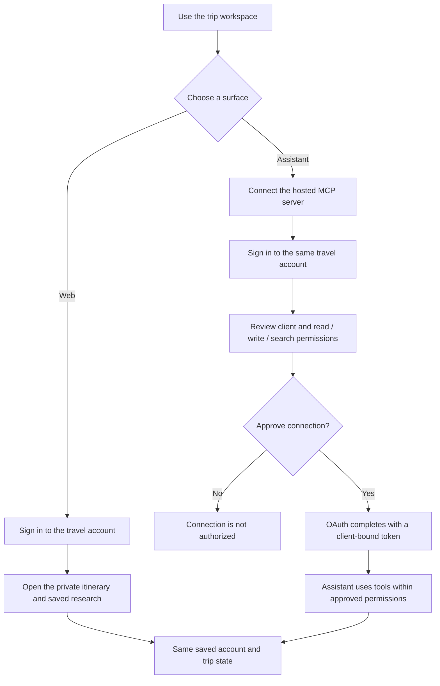
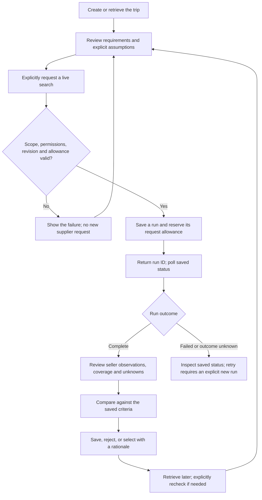
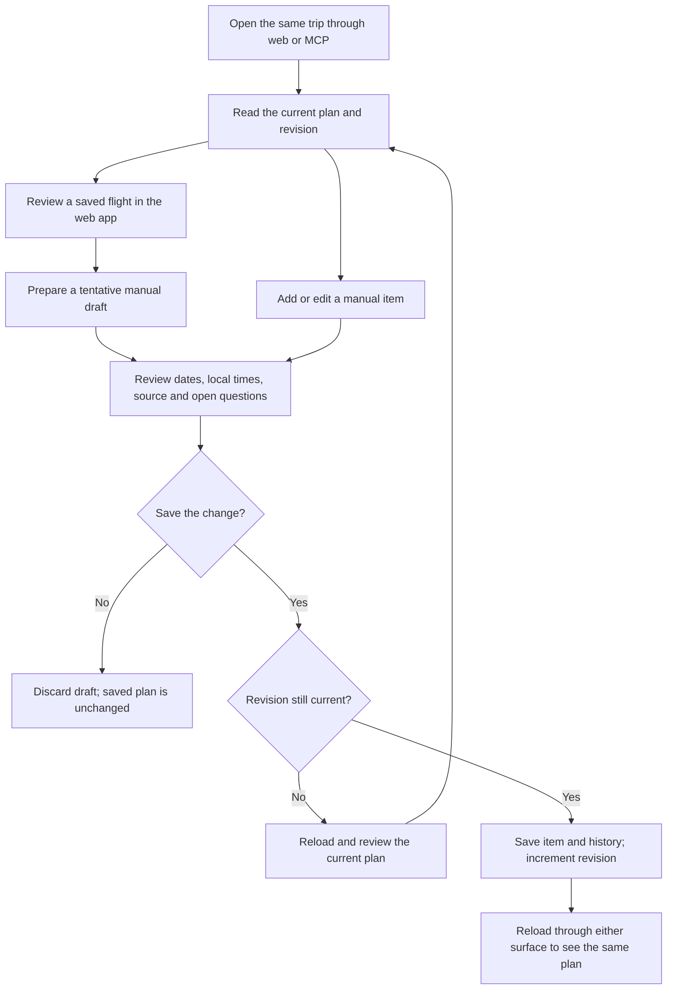
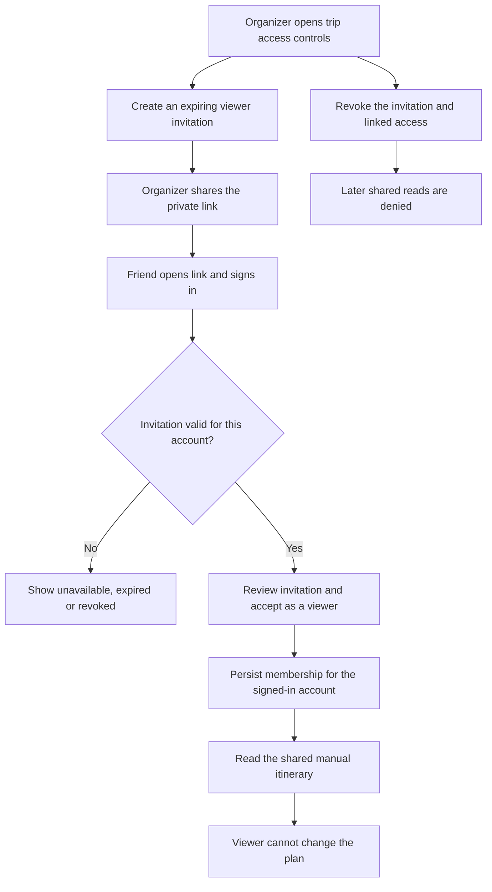
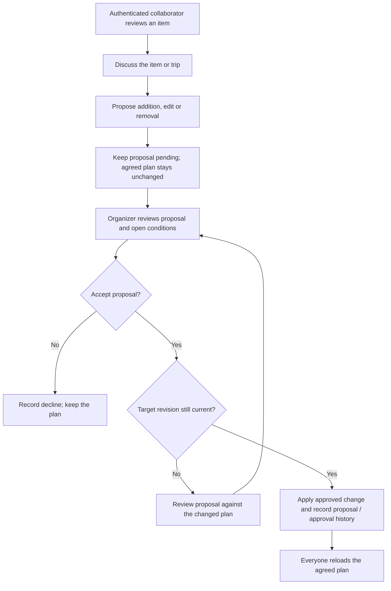

# User flow diagrams

Updated 14 October 2026. The diagrams describe the recorded deployed release unless marked **work in progress** or **target flow**. Implementation does not imply that every end-to-end acceptance step has been verified. See [architecture](architecture.md), [database ER diagrams](database.md) and [delivery evidence](implementation.md).

## Sign in and connect an assistant

Web and MCP use the same account, with different session/permission boundaries. Initial direct sign-in and official-SDK OAuth passed; ChatGPT linking/retrieval has recorded proof. Other-assistant and refresh/revocation acceptance remain separate.

Web sign-in does not grant an assistant access. Assistant tokens cannot manage account connections; the user manages consent/revocation through the account page. Identity scopes and application permissions are separate. See [account linking](account-linking.md).

## Research flights through an assistant

The current search entry point is MCP. The web app can read saved research and prepare itinerary drafts, but direct web search/comparison/outcome controls remain further delivery work. The pilot covers one direct Gatwick–Geneva pair and up to ten sellers.

The runner performs bounded supplier stages after admission. Repeating an identical mutation returns the original run; polling or retrieving saved research does not initiate a new search. The failure branch does not instruct the user to retry a new run blindly: inspect ambiguous outcomes and available allowance first. See [pilot execution/recovery](hosted-live-search.md#persistence-cost-and-recovery).

Known hard-constraint failures block selection; unresolved conditions require explicit acknowledgment. Selection is not a booking. The user may book outside the product and separately record that report through MCP; no ticket purchase or reservation is performed by this service.

## Organize the itinerary and continue across surfaces

Manual item writes are implemented in both surfaces. Saved-flight review prepares a draft in the web app. Real hosted research reads agree; a complete hosted manual edit round trip remains an acceptance gap.

A copied research draft remains tentative and never creates a research selection or booking. A matching existing flight opens for editing rather than automatically adding another copy. The saved manual item is a snapshot; new research does not update it automatically. Booked labels require an explicit user report and booking note. See [itinerary behavior](itinerary-web.md).

## Viewer invitation — work in progress

This flow describes the local viewer-sharing extension in migration 006, not deployed acceptance. Invitation management is through the direct-session web surface. The local read projection excludes research, owner history and booking notes for viewers.

An invitation URL is a route to authenticated membership, not anonymous publication. It does not grant access to the owner's account-private research or assistant connections. Source: [local sharing implementation](../src/itinerary-sharing.ts) and [ER extension](database.md#viewer-sharing-extension--work-in-progress).

## Collaborator proposal and approval — target flow

This is the agreed product direction from the PRD. It is not implemented by the viewer-only migration. Collaborators can discuss and propose; only the organizer changes the agreed plan. Comments/proposals do not constitute a booking.

Role enforcement, revocation, proposal conflicts, shared history and booking-detail visibility need implementation and real collaboration acceptance. See [the collaboration requirements](prd.md#itinerary-foundation-and-collaboration).
